# 1. 项目概述

掌柜问数是一个基于自然语言处理与数据分析技术的智能数据服务系统，面向**数据仓库**应用场景，旨在帮助用户通过对话方式高效获取数据仓库中的数据洞察。用户无需掌握复杂的查询语法，即可用自然语言提出问题，系统自动完成对数据仓库数据的理解、计算分析与结果可视化，大幅提升数据使用效率，降低数据分析门槛，助力业务决策智能化。

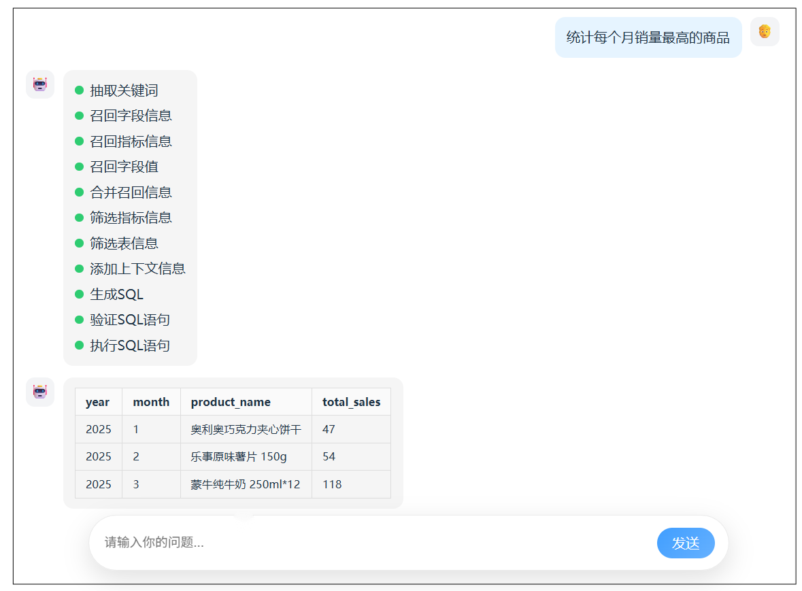

数据仓库（DW-Data Warehouse）是**面向分析、集成化、非易失性、随时间变化**的**企业级数据存储系统**，核心作用是把企业分散在各个业务系统（如电商的交易系统、物流的仓储系统、CRM 的客户系统、 Elasticsearch/Qdrant 检索库、MySQL 业务库等）的零散数据，经过**抽取、清洗、转换、加载** 后，按**主题域**整合存储，最终支撑企业的**数据分析、报表统计、经营决策、数据挖掘**等场景。

数仓数据来源

1）业务系统对应业务库，是数仓**最主要、最基础**的数据来源。

- 关系型数据库MySQL、SQL Server、Oracle等
- 订单、用户、商品、支付、物流、会员、库存等
- 方式：**CDC（实时）、全量 / 增量获取**

2）日志数据（行为数据）

用户行为、系统行为、埋点数据。

- App / 小程序 / 网站埋点日志
- 服务端日志、Nginx 日志
- 方式：**Kafka、Logstash**采集

简单说：**业务库管 “干活”（支撑日常交易 / 操作），数据仓库管 “复盘”（支撑分析 / 决策）**,**掌柜问数 —— 问一句，出报表，人人都是数据掌柜**

项目意义：告别写 SQL，告别等数据，自然语言一问，秒出结果、秒懂经营。让数据会说话，让决策更简单。

- 不用代码、不用 SQL、不用培训
- 像聊天一样，用日常语言问业务、查指标、看趋势
- 自动理解表结构、生成 SQL、返回可视化 结果
- 业务人员自助查数，数据团队解放双手
- 让每一位管理者、运营、业务员，都能轻松掌数

# 2. 项目架构

## 2.1 概述

​	本项目以数据仓库的元数据为核心，使用 MySQL 存储结构化元数据信息，结合 Qdrant 构建语义向量索引、Elasticsearch 构建全文索引，形成统一的元数据知识库。查询过程中，系统首先根据用户自然语言问题进行多路召回，筛选相关表、字段及指标定义，再将元数据信息与用户问题共同输入大模型生成 SQL，最终完成自动查询与结果返回，确保生成结果的准确性与可控性。

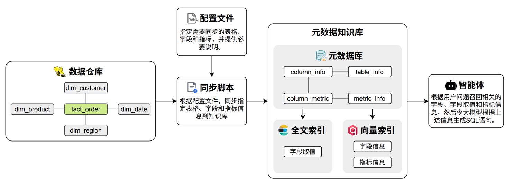 

## 2.2 数仓-数据库

数据仓库采用了数据仓库领域最经典的**星型模型**：

**事实表（Fact Table）**：`fact_order`（订单事实表）—— 存储核心业务交易数据（“发生了什么”）；

**维度表（Dimension Table）**：`dim_region`/`dim_customer`/`dim_product`/`dim_date`（4 张维度表）—— 存储描述性信息（“交易的上下文”）；

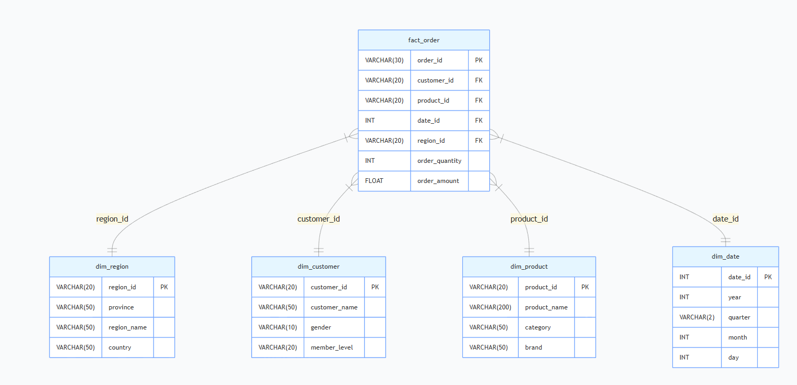

1. 事实表：`fact_order`（核心业务数据）

   | 字段             | 类型        | 作用                     | 示例                            |
   | ---------------- | ----------- | ------------------------ | ------------------------------- |
   | `order_id`       | VARCHAR(30) | 订单主键（唯一标识订单） | `ORD20250101001`                |
   | `customer_id`    | VARCHAR(20) | 关联客户维度表           | `C001`（对应李伟）              |
   | `product_id`     | VARCHAR(20) | 关联产品维度表           | `P001`（对应 iPhone 15 Pro）    |
   | `date_id`        | INT         | 关联日期维度表           | `20250101`（2026 年 1 月 1 日） |
   | `region_id`      | VARCHAR(20) | 关联区域维度表           | `R001`（对应广东省）            |
   | `order_quantity` | INT         | 订单数量（度量值）       | `1`（购买 1 台手机）            |
   | `order_amount`   | FLOAT       | 订单金额（核心度量值）   | `8999.00`（iPhone 15 Pro 售价） |

2. 维度表（描述上下文）

   | 维度表         | 核心字段                 | 作用         | 典型分析维度                                |
   | -------------- | ------------------------ | ------------ | ------------------------------------------- |
   | `dim_region`   | `province`/`region_name` | 订单所属区域 | 按省份 / 大区（华南 / 华东）分析销量        |
   | `dim_customer` | `gender`/`member_level`  | 客户属性     | 按性别 / 会员等级分析消费能力               |
   | `dim_product`  | `category`/`brand`       | 产品属性     | 按品类（手机数码 / 家用电器）/ 品牌分析销量 |
   | `dim_date`     | `year`/`quarter`/`month` | 时间属性     | 按年 / 季度 / 月分析销售趋势                |

数据仓库的核心价值：

**分析灵活**：星型模型支持 “多维度组合分析”，比如：

- 分析 “2026 年 Q1 华东地区黄金会员购买手机数码类产品的总金额”；
- 分析 “2026 年 2 月广东省女性客户购买家用电器的订单数量”；

**性能优化**：维度表数据量小（比如`dim_customer`只有 20 条），事实表数据量大但结构简单，关联查询效率高；

**灵活扩展**：新增维度（如`dim_payment`支付方式）只需加一张维度表，不影响现有表结构。

典型查询场景：

场景 1：2026 年 Q1 总订单金额  **预期结果**：所有 2026 年 1-3 月订单金额总和（约 50 万 +）。

```sql
SELECT SUM(f.order_amount) AS total_amount
FROM fact_order f
JOIN dim_date d ON f.date_id = d.date_id
WHERE d.year = 2026 AND d.quarter = 'Q1';
```

场景 2：2026 年 1 月各省份订单金额排名: **预期结果**：广东省（R001）、上海市（R005）、浙江省（R002）金额靠前。

```sql
SELECT r.province, SUM(f.order_amount) AS province_amount
FROM fact_order f
JOIN dim_region r ON f.region_id = r.region_id
JOIN dim_date d ON f.date_id = d.date_id
WHERE d.year = 2026 AND d.month = 1
GROUP BY r.province
ORDER BY province_amount DESC;
```

场景 3：黄金会员购买苹果品牌产品的总数量 **预期结果**：黄金会员购买苹果产品的总数量（比如李伟、张敏等黄金会员购买的 iPhone 15 Pro 数量）

```sql
SELECT p.category, SUM(f.order_amount) AS category_amount
FROM fact_order f
JOIN dim_product p ON f.product_id = p.product_id
JOIN dim_date d ON f.date_id = d.date_id
WHERE d.year = 2026 AND d.month = 2
GROUP BY p.category
ORDER BY category_amount DESC;
```

场景 4：2026 年 2 月各产品品类的订单金额 **预期结果**：手机数码类（iPhone/Samsung/ 华为）金额最高，其次是家用电器。

```sql
SELECT SUM(f.order_amount) AS female_platinum_amount
FROM fact_order f
JOIN dim_customer c ON f.customer_id = c.customer_id
JOIN dim_date d ON f.date_id = d.date_id
WHERE d.year = 2026 AND d.quarter = 'Q1'
  AND c.gender = '女' AND c.member_level = '铂金';
```

场景 5：2026 年 Q1 女性铂金会员的消费金额 **预期结果**：陈静、周燕、高梅等铂金女性会员的总消费金额。

```sql
SELECT SUM(f.order_amount) AS female_platinum_amount
FROM fact_order f
JOIN dim_customer c ON f.customer_id = c.customer_id
JOIN dim_date d ON f.date_id = d.date_id
WHERE d.year = 2026 AND d.quarter = 'Q1'
  AND c.gender = '女' AND c.member_level = '铂金';
```

## 2.3 元数据知识库


元数据知识库是**数据仓库的 “说明书中心”**—— 它把数据仓库里的表、字段、指标等信息，统一整理成 “结构化的元数据”，让智能体（或用户）能快速理解数据仓库的结构，最终实现 “用自然语言生成 SQL 查询” 的目标。

元数据知识库作为数据仓库的语义基础设施，用于集中管理和高效检索表结构、字段定义、字段取值示例及复杂指标说明等元数据信息，支撑后续的智能检索与 SQL 生成。


元数据信息主要来源于两部分：一部分数据仓库自动采集，另一部分由人工进行补充与配置。完整的元数据统一存储于 MySQL 数据库中，并对其中部分关键信息构建向量索引和全文索引，以提升语义召回与关键词召回的效果。

### 2.3.1 元数据库

元数据库共包含四张表，具体结构如下图所示：

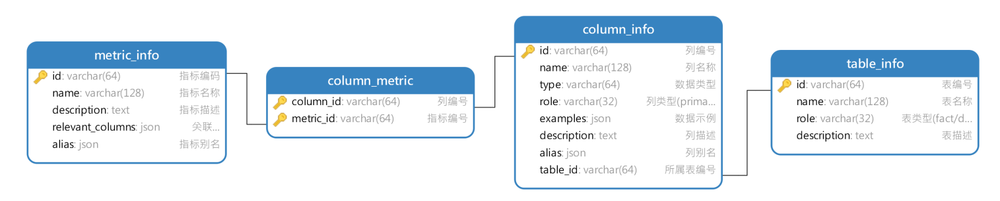

**元数据库核心表转换过程：**

1. 转换到`table_info`（表信息）

   | table_info 字段 | 填入的内容（以`fact_order`为例）           |
   | --------------- | ------------------------------------------ |
   | id              | fact_order（表名作为ID）                   |
   | name            | fact_order                                 |
   | role            | fact （角色：事实表）                      |
   | description     | 订单事实表，记录订单数量和金额等核心指标。 |

   | table_info 字段 | 填入的内容（以`dim_region`为例）             |
   | --------------- | -------------------------------------------- |
   | id              | dim_region（表名作为ID）                     |
   | name            | dim_region                                   |
   | role            | dim  （角色：维度表）                        |
   | description     | 地区维度表，用于描述订单发生的地理区域信息。 |

   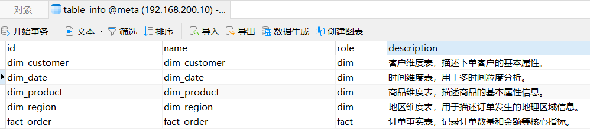 

2. 转换到`column_info`（字段信息）

   | column_info 字段 | 填入的内容（以`fact_order.order_amount`为例）  |
   | ---------------- | ---------------------------------------------- |
   | id               | fact_order.order_amount（表名.列名）           |
   | name             | order_amount                                   |
   | type             | FLOAT                                          |
   | role             | measure （角色：度量）                         |
   | examples         | ["8999.00", "6999.00"]（JSON 格式）            |
   | description      | 订单实付金额，单位：元，不含运费 / 优惠        |
   | alias            | ["订单金额", "实付金额"]（JSON 格式）          |
   | table_id         | table_fact_order（关联 meta.table_info 的 id） |

   | column_info 字段 | 填入的内容（以`dim_customer`为例）               |
   | ---------------- | ------------------------------------------------ |
   | id               | dim_customer.member_level（自定义唯一 ID）       |
   | name             | member_level                                     |
   | type             | varchar(20)                                      |
   | role             | dimension 解释：维度                             |
   | examples         | ["黄金", "白银", "青铜", "铂金", "钻石", "星耀"] |
   | description      |                                                  |
   | alias            | ["会员等级", "用户等级"]（JSON 格式）            |
   | table_id         | dim_customer（关联 meta.dim_customer的 id）      |

   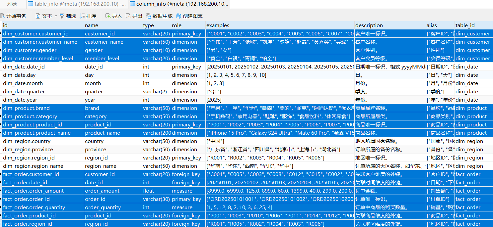

3. `metric_info`（指标信息）

   | metric_info 字段 | 填入的内容（以 “订单金额” 为例）                          |
   | ---------------- | --------------------------------------------------------- |
   | id               | GMV                                                       |
   | name             | GMV                                                       |
   | description      | 全称Gross Merchandise Value，表示所有订单的成交金额总和。 |
   | relevant_columns | ["fact_order.order_amount"]（JSON 格式）                  |
   | alias            | [成交总额, 订单总额]（JSON 格式）                         |

   **计算逻辑：SUM(fact_order.order_amount)**

   | metric_info 字段 | 填入的内容（以 “平均订单金额” 为例）                    |
   | ---------------- | ------------------------------------------------------- |
   | id               | AOV                                                     |
   | name             | AOV                                                     |
   | description      | 全称Average Order Value，表示所有订单的成交金额平均值。 |
   | relevant_columns | ["fact_order.order_quantity"]（JSON 格式）              |
   | alias            | [平均单价、平均订单金额]（JSON 格式）                   |

   **计算逻辑：SUM(fact_order.order_amount) / COUNT(DISTINCT fact_order.order_id)**

4. 转换到`column_metric`（字段 - 指标关联）

   | column_metric 字段 | 填入的内容（关联 “省份月度销售额” 指标）  |
   | ------------------ | ----------------------------------------- |
   | column_id          | fact_order_order_amount（关联金额字段）   |
   | metric_id          | GMV                                       |
   | column_id          | fact_order_order_quantity（关联数量字段） |
   | metric_id          | AOV                                       |

**元数据知识库录入数据仓库信息**：

- `table_info`录入`fact_order`/`dim_region`等表的信息（表名、类型`fact/dim`、描述）；
- `column_info`录入各表字段信息（比如`order_amount`的类型`FLOAT`、角色`measure`、描述 “订单金额”）；
- `metric_info`录入业务指标（比如 “省份月度销售额” 关联`fact_order.order_amount`+`dim_region.province`+`dim_date.month`）；

**智能体基于元数据生成 SQL**：

用户问 “2026 年 Q1 华东地区黄金会员购买手机数码类产品的总金额”，智能体通过元数据知识库匹配：

- 指标：总金额 → 关联`fact_order.order_amount`；

- 维度：2026 年 Q1 → 关联`dim_date.year=2026`+`quarter='Q1'`；

- 维度：华东地区 → 关联`dim_region.region_name='华东'`；

- 维度：黄金会员 → 关联`dim_customer.member_level='黄金'`；

- 维度：手机数码类 → 关联`dim_product.category='手机数码'`;

  最终自动生成对应的 JOIN 查询 SQL。

> 一句话总结：数据仓库是 “数据载体”，元数据知识库是 “数据说明书”，两者结合实现 “自然语言转 SQL” 的智能分析。

### 2.3.2 向量索引

本项目选用 [Qdrant](https://qdrant.tech/) 作为向量数据库，向量索引主要用于对**字段信息**和**指标信息**进行语义召回。向量索引的构建内容具体如下：

#### 字段信息

column_info 需要建立向量索引的字段如下图所示：

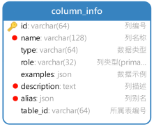

具体示例如下图所示：

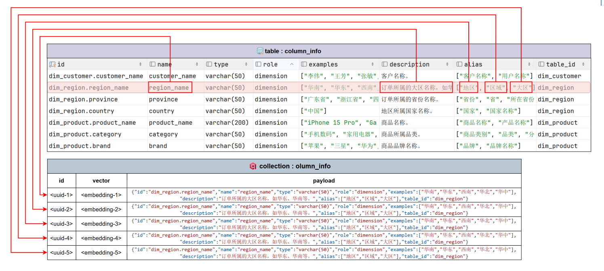


#### 指标信息

metric_info 需要建立向量索引的字段如下图所示：

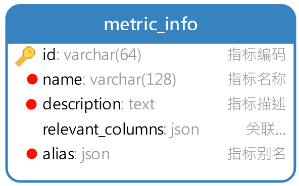

具体示例如下图所示：

 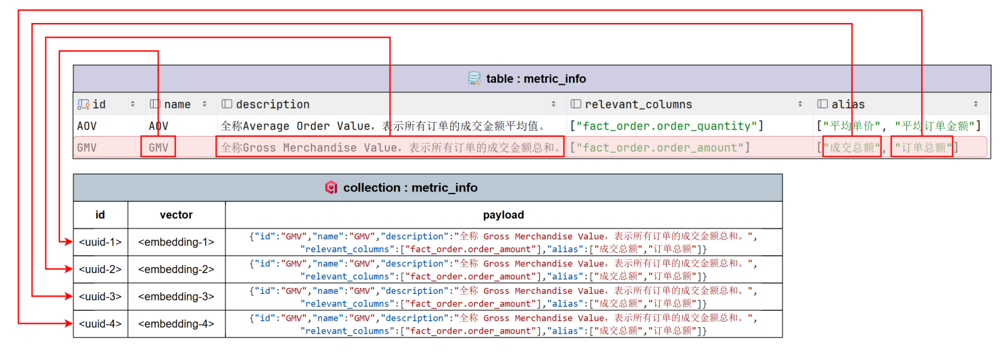

### 2.3.4 全文索引

本项目使用 Elasticsearch 作为全文检索引擎，全文索引主要用于对**字段取值**进行检索与匹配，索引内容以各类维度值为主，具体如下：

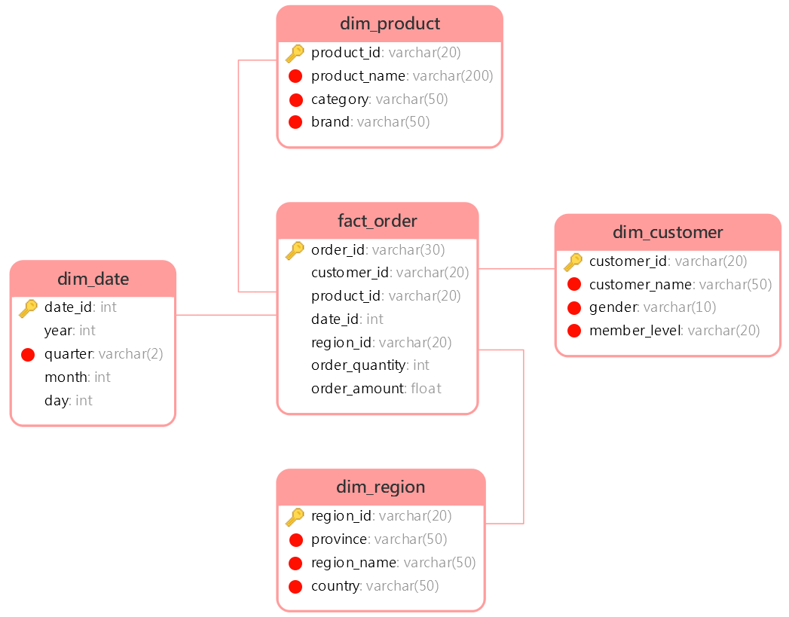

具体示例如下图所示：

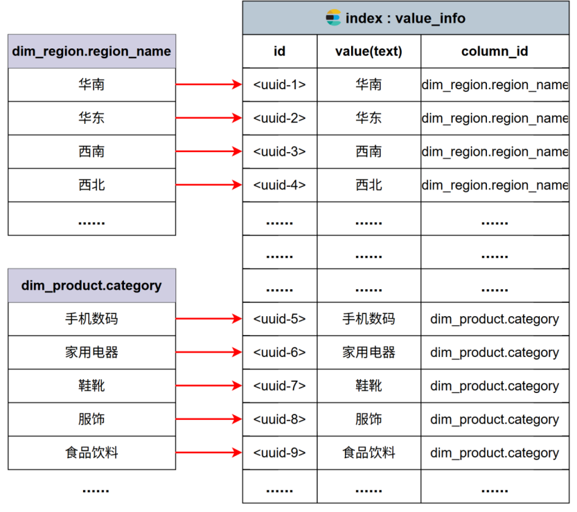

## 2.4 问数智能体

本项目的智能体主体基于Langgraph构建，具体结构如下图所示：

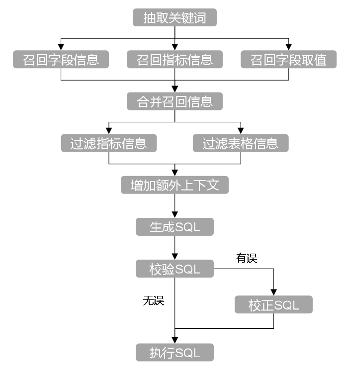


# 3. 项目开发环境

## 3.1 创建项目

1.在anaconda命令行里新建虚拟环境：

```bash
conda remove -n py312 --all # 可选：直接删除环境及所有安装的包
conda create -n py312 python=3.12 #创建虚拟环境执行Python版本
```

2.激活环境：

```bash
conda activate py312
```

3.下载项目所需的全部依赖：

```bash
pip install asyncmy cryptography "elasticsearch[async]>=8,<9" fastapi[standard] huggingface-hub jieba langchain langchain-deepseek langchain-huggingface langgraph loguru omegaconf pyyaml qdrant-client sqlalchemy
```

各依赖说明如下：

- fastapi[standard]：高性能异步 Web 框架，作为整个服务的 API 入口。

- sqlalchemy：Python 最主流 ORM，用统一模型管理数据库读写与事务。

- asyncmy：MySQL 的高性能 asyncio 驱动，配合 SQLAlchemy 实现全异步数据库访问。

- qdrant-client：向量数据库客户端，用于 Embedding 向量存储与相似度检索。

- elasticsearch[async]：异步 Elasticsearch 客户端，用于全文检索。

- langchain：LLM 应用编排框架，用于构建 RAG、Tool 调用、Prompt 链路。

- langchain-huggingface：LangChain 与 HuggingFace 模型的桥接层（Embedding / LLM 加载）。

- langgraph：用图结构构建可控 Agent 流程。

- jieba：中文分词库。

- omegaconf：强大的分层配置系统，适合多环境、多模型、多参数管理。

- pyyaml：YAML导入导出。

- loguru：更优雅的日志库，替代 logging，适合工程化项目。

- cryptography：加密与证书基础库，很多网络/数据库/安全库的底层依赖。

本项目使用 `python 3.12版本及以上`，如下图所示

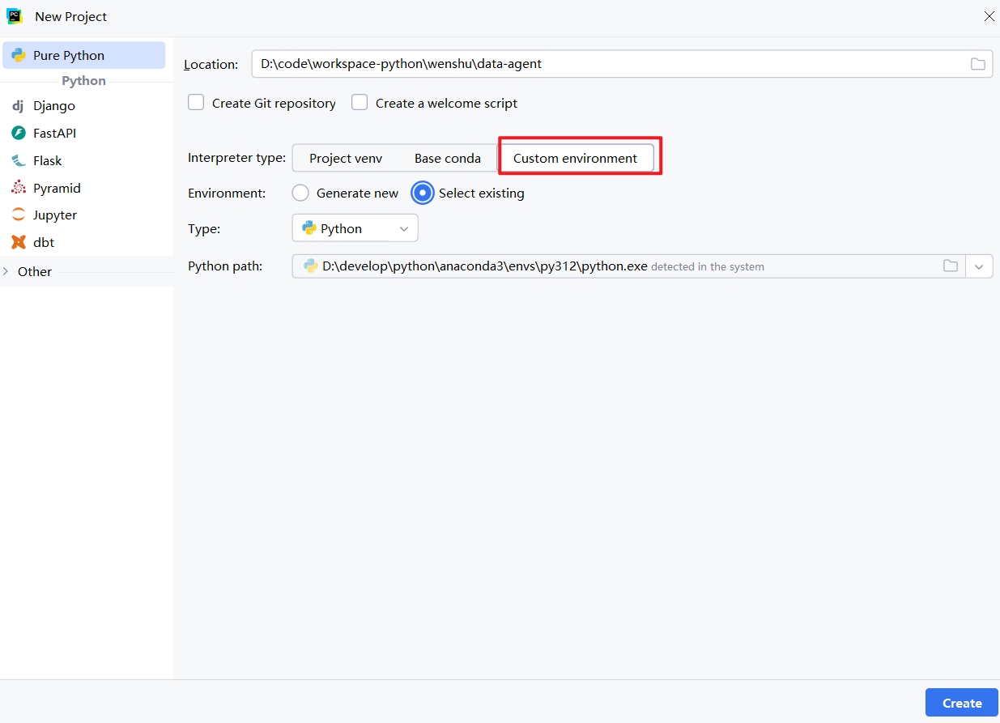

## 3.2 搭建开发环境

本项目采用 Docker 管理开发环境，相关容器配置文件已提供于课程资料中的 `docker` 目录。将该目录拷贝至项目根目录后，进入 `docker` 目录并执行 `docker compose up -d`，即可一键启动项目所需的全部基础服务。

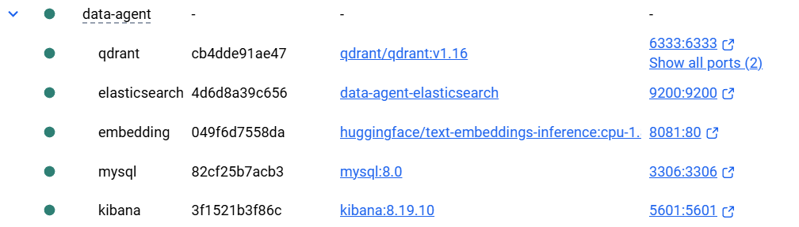

下发资料虚拟机信息: 192.168.200.10  root/root 

|     容器      | URL                        |     账号密码     |
| :-----------: | :------------------------- | :--------------: |
|    qdrant     | http://192.168.200.10:6333 |        无        |
|     MySQL     | 192.168.200.10:3306        | root/Atguigu.123 |
| Elasticsearch | http://192.168.200.10:9200 |        无        |
|    Kibana     | http://192.168.200.10:5601 |        无        |
|   embedding   | http://192.168.200.6:8081  |        无        |

## 3.3 安装所需服务

### 3.3.1 服务说明

本项目所需的全部服务如下：

- MySQL

MySQL 用于存储数据仓库的元数据信息，包括表格信息、字段信息和指标信息，同时也充当业务数据仓库使用（模拟 Hive 场景）。

- Qdrant

Qdrant 作为向量数据库，用于存储字段信息、指标信息的向量表示，在用户提问时通过语义相似度检索出最相关的元数据，为生成SQL提供高相关性的上下文信息。

- Elasticsearch

Elasticsearch 对各维度字段的实际取值建立倒排索引。当用户问题中包含自然语言形式的维度描述时（例如“华北地区”、“数码品类”），可通过全文检索匹配到数据库中真实存在的字段取值，为生成 SQL 时的 WHERE 条件或者GROUP BY分组提供准确依据。

- Kibana

Kibana 是 Elasticsearch 的可视化管理与调试界面，用于索引管理、查询语句调试以及检索效果验证，方便开发过程中观察和优化检索行为。

- Text Embedding Inference

Text Embedding Inference 用于部署 Embedding 模型推理服务，将元数据文本及用户问题转换为向量表示，为 Qdrant 提供向量数据来源，是语义检索能力的基础。

### 3.3.2 安装

​	本项目所需的全部基础服务通过 Docker Compose 统一部署。

1. 找到课后资料相关镜像文件，将文件上传到centos服务器

    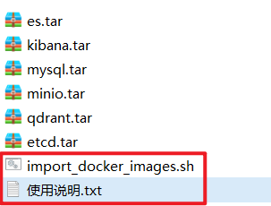

2. 将资料中中dockercompose相关资料上传服务，执行导入docker镜像脚本，将所需docker镜像导入，减少下载镜像时间

    ```bash
    chmod +x import_docker_images.sh
    ./import_docker_images.sh
    ```

3. 相关脚本与依赖文件已包含在项目资料中。进入 docker-compose.yaml 所在目录，执行以下命令即可完成所有服务的安装与启动：

   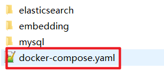
   
   ```bash
   #启动所有docker服务
   docker compose up -d 
   ```
   
   

# 4. 基础设施搭建

## 4.1 项目目录结构

```yaml
data-agent 根目录
├── app 代码目录
│   ├── clients 数据库客户端
│   ├── conf 配置类
│   ├── core 基础设施
├── conf 配置文件
├── logs 日志目录
```

## 4.2 应用配置参数管理

### 4.2.1 应用配置文件

本项目采用 YAML 文件管理配置参数，配置文件的路径为 `data-agent/conf/app_config.yaml` 。以下是本项目所需的全部参数。

```yaml
logging:
  file:
    enable: true
    level: INFO
    path: logs
    rotation: "10 MB"
    retention: "7 days"
  console:
    enable: true
    level: INFO

db_meta:
  host: localhost
  port: 3306
  user: atguigu
  password: Atguigu.123
  database: meta

db_dw:
  host: localhost
  port: 3306
  user: atguigu
  password: Atguigu.123
  database: dw

qdrant:
  host: localhost
  port: 6333
  embedding_size: 1024

embedding:
  host: localhost
  port: 8081
  model: BAAI/bge-large-zh-v1.5


es:
  host: localhost
  port: 9200
  index_name: data_agent


llm:
  model_name: deepseek-chat
  api_key: <deepseek_api_key>

```

### 4.1.2 加载工具

本项目使用的yaml配置文件加载工具为[OmegaConf](https://omegaconf.readthedocs.io/en/2.3_branch/index.html)，具体用法参考其官网即可。

用于读取配置文件的代码放置在`data-agent/app/conf/app_config.py`文件中，具体内容如下：

```python
from dataclasses import dataclass
from pathlib import Path

from omegaconf import OmegaConf


# 日志配置
@dataclass
class File:
    enable: bool
    level: str
    path: str
    rotation: str
    retention: str


@dataclass
class Console:
    enable: bool
    level: str


@dataclass
class LoggingConfig:
    file: File
    console: Console


# 数据库配置
@dataclass
class DBConfig:
    host: str
    port: int
    user: str
    password: str
    database: str


@dataclass
class QdrantConfig:
    host: str
    port: int
    embedding_size: int


@dataclass
class EmbeddingConfig:
    host: str
    port: int
    model: str


@dataclass
class ESConfig:
    host: str
    port: int
    index_name: str


@dataclass
class LLMConfig:
    model_name: str
    api_key: str


@dataclass
class AppConfig:
    logging: LoggingConfig
    db_meta: DBConfig
    db_dw: DBConfig
    qdrant: QdrantConfig
    embedding: EmbeddingConfig
    es: ESConfig
    llm: LLMConfig


config_file = Path(__file__).parents[2] / 'conf' / 'app_config.yaml'
context = OmegaConf.load(config_file)
schema = OmegaConf.structured(AppConfig)
app_config: AppConfig = OmegaConf.to_object(OmegaConf.merge(schema, context))
```

## 4.3 MySQL客户端管理

本项目中的MySQL客户端使用[SQLAlchemy](https://www.sqlalchemy.org/)，具体用法参考官方文档。

在`data-agent/app/clients/mysql_client_manager.py`中编写如下代码，用来管理MySQL客户端。

```python
import asyncio

from sqlalchemy import text
from sqlalchemy.ext.asyncio import create_async_engine, async_sessionmaker

from app.conf.app_config import DBConfig, app_config


class MySQLClientManager:
    def __init__(self, db_config: DBConfig):
        self.db_config = db_config
        self.engine = None
        self.session_factory = None

    def _get_url(self):
        return f"mysql+asyncmy://{self.db_config.user}:{self.db_config.password}@{self.db_config.host}:{self.db_config.port}/{self.db_config.database}?charset=utf8mb4"

    def init(self):
        self.engine = create_async_engine(self._get_url())
        self.session_factory = async_sessionmaker(self.engine)

    async def close(self):
        if self.engine:
            await self.engine.dispose()


dw_mysql_client_manager = MySQLClientManager(app_config.db_dw)
meta_mysql_client_manager = MySQLClientManager(app_config.db_meta)

if __name__ == '__main__':
    dw_mysql_client_manager.init()


    async def test():
        async with dw_mysql_client_manager.session_factory() as session:
            result = await session.execute(text("show tables;"))
            print(result.fetchall())


    asyncio.run(test())
```

## 4.4 Embedding客户端管理

本项目中的Text Embedding Inference客户端使用HuggingFaceEndpointEmbeddings，具体用法参考[官方文档](https://docs.langchain.com/oss/python/integrations/text_embedding/text_embeddings_inference)。

在`data-agent/app/clients/embedding_client_manager.py`中编写如下代码，用来管理Text Embedding Inference客户端。

```python
from langchain_huggingface import HuggingFaceEndpointEmbeddings

from app.config.app_config import EmbeddingConfig, app_config


class EmbeddingClientManager:
    def __init__(self, config: EmbeddingConfig):
        self.config = config
        self.client: HuggingFaceEndpointEmbeddings | None = None

    def init(self):
        self.client = HuggingFaceEndpointEmbeddings(model=f"http://{self.config.host}:{self.config.port}")


embedding_client_manager = EmbeddingClientManager(app_config.embedding)

if __name__ == '__main__':
    client = EmbeddingClientManager(app_config.embedding)
    client.init()
    query = client.client.embed_query("hello world")
    print(len(query))
    print(query)

```


## 4.5 Qdrant客户端管理

本项目中向量数据库采用Qdrant，Qdrant客户端使用[qdrant-client](https://python-client.qdrant.tech/)，具体用法参考官方文档。

在`data-agent/app/clients/qdrant_client_manager.py`中编写如下代码，用来管理Qdrant客户端。

```python
import asyncio
import random
from typing import Optional

from qdrant_client import AsyncQdrantClient, models

from app.config.app_config import QdrantConfig
from app.models import qdrant


class QdrantClientManager:
    def __init__(self, qdrant_config: QdrantConfig):
        self.qdrant_config = qdrant_config
        self.client: Optional[AsyncQdrantClient] = None

    def _get_url(self):
        return f"http://{self.qdrant_config.host}:{self.qdrant_config.port}"

    def init(self):
        self.client = AsyncQdrantClient(url=self._get_url())

    async def close(self):
        await self.client.close()


qdrant_client_manager = QdrantClientManager(qdrant)

if __name__ == '__main__':
    qdrant_client_manager.init()


    async def test():
        client = qdrant_client_manager.client
        if not await client.collection_exists("my_collection"):
            await client.create_collection(
                collection_name="my_collection",
                vectors_config=models.VectorParams(size=10, distance=models.Distance.COSINE),
            )

        await client.upsert(
            collection_name="my_collection",
            points=[
                models.PointStruct(
                    id=i,
                    vector=[random.random() for _ in range(10)],
                )
                for i in range(100)
            ],
        )

        res = await client.query_points(
            collection_name="my_collection",
            query=[random.random() for _ in range(10)],  # type: ignore
            limit=10,
            score_threshold=0.8
        )

        print(res)
    asyncio.run(test())
```

## 4.6 ES客户端管理

本项目中的ES客户端使用[elasticsearch](https://www.elastic.co/docs/reference/elasticsearch/clients/python)，具体用法参考官方文档。

在`data-agent/app/clients/es_client_manager.py`中编写如下代码，用来管理ES客户端。

```python
import asyncio
from typing import Optional

from elasticsearch import AsyncElasticsearch

from app.conf.app_config import ESConfig, app_config


class ESClientManager:
    def __init__(self, es_config: ESConfig):
        self.es_config = es_config
        self.client: Optional[AsyncElasticsearch] = None

    def _get_url(self):
        return f"http://{self.es_config.host}:{self.es_config.port}"

    def init(self):
        self.client = AsyncElasticsearch(hosts=[self._get_url()])

    async def close(self):
        await self.client.close()


es_client_manager = ESClientManager(app_config.es)

if __name__ == '__main__':
    es_client_manager.init()


    async def test():
        client = es_client_manager.client

        # 创建索引
        await client.indices.create(
            index="my-books",
            mappings={
                "dynamic": False,
                "properties": {
                    "name": {
                        "type": "text"
                    },
                    "author": {
                        "type": "text"
                    },
                    "release_date": {
                        "type": "date",
                        "format": "yyyy-MM-dd"
                    },
                    "page_count": {
                        "type": "integer"
                    }
                }
            },
        )

        # 插入数据
        await client.bulk(
            operations=[
                {
                    "index": {
                        "_index": "my-books"
                    }
                },
                {
                    "name": "Revelation Space",
                    "author": "Alastair Reynolds",
                    "release_date": "2000-03-15",
                    "page_count": 585
                },
                {
                    "index": {
                        "_index": "my-books"
                    }
                },
                {
                    "name": "1984",
                    "author": "George Orwell",
                    "release_date": "1985-06-01",
                    "page_count": 328
                },
                {
                    "index": {
                        "_index": "my-books"
                    }
                },
                {
                    "name": "Fahrenheit 451",
                    "author": "Ray Bradbury",
                    "release_date": "1953-10-15",
                    "page_count": 227
                },
                {
                    "index": {
                        "_index": "my-books"
                    }
                },
                {
                    "name": "Brave New World",
                    "author": "Aldous Huxley",
                    "release_date": "1932-06-01",
                    "page_count": 268
                },
                {
                    "index": {
                        "_index": "my-books"
                    }
                },
                {
                    "name": "The Handmaids Tale",
                    "author": "Margaret Atwood",
                    "release_date": "1985-06-01",
                    "page_count": 311
                }
            ],
        )

        # 搜索
        resp = await client.search(
            index="my-books",
            query={
                "match": {
                    "name": "brave"
                }
            },
        )
        print(resp)
        await es_client_manager.close()


    asyncio.run(test())
```


## 4.7 日志管理

本项目使用[loguru](https://loguru.readthedocs.io/en/stable/#readme)管理日志，具体用法参考官网。

在`data-agent/app/core/log.py`中编写如下代码，统一管理日志。

```python
import asyncio
import sys
from pathlib import Path
from loguru import logger
from app.conf.app_config import app_config
from app.core.context import request_id_ctx_var

# 配置日志格式
log_format = (
    "<green>{time:YYYY-MM-DD HH:mm:ss.SSS}</green> | "
    "<level>{level: <8}</level> | "
    "<magenta>request_id - {extra[request_id]}</magenta> | "
    "<cyan>{name}</cyan>:<cyan>{function}</cyan>:<cyan>{line}</cyan> - "
    "<level>{message}</level>"
)


# 注入request_id到日志记录中
def inject_request_id(record):
    request_id = request_id_ctx_var.get()
    record["extra"]["request_id"] = request_id


logger.remove()

# 给日志打补丁，使其支持注入request_id
logger = logger.patch(inject_request_id)

# 控制台日志（保持原有逻辑）
if app_config.logging.console.enable:
    logger.add(sink=sys.stdout, level=app_config.logging.console.level, format=log_format)

# 文件日志：修改为项目根目录下的 logs 文件夹
if app_config.logging.file.enable:
    # 1. 获取项目根目录（当前文件所在目录的上层/上层，根据实际结构调整）
    # 核心逻辑：__file__ 是当前文件路径，.parent 向上找根目录
    # 如果你不确定层级，可以打印调试：print(Path(__file__).absolute())
    PROJECT_ROOT = Path(__file__).parents[2]  # 根据实际项目结构调整
    # 2. 拼接日志路径：项目根目录 / logs / app.log
    LOG_DIR = PROJECT_ROOT / "logs"
    LOG_FILE = LOG_DIR / "app.log"

    # 3. 创建日志目录（确保存在）
    LOG_DIR.mkdir(parents=True, exist_ok=True)

    # 4. 添加文件日志处理器
    logger.add(
        sink=LOG_FILE,
        level=app_config.logging.file.level,
        format=log_format,
        rotation=app_config.logging.file.rotation,
        retention=app_config.logging.file.retention,
        encoding="utf-8"
    )

if __name__ == '__main__':
    async def print_log(request: str):
        # 打印日志
        logger.info(request)


    async def test1():
        # 接收到请求
        request_id_ctx_var.set("request-1")
        # 模拟处理
        await asyncio.sleep(1)
        await print_log("request-1")


    async def test2():
        # 接收到请求
        request_id_ctx_var.set("request-2")

        # 模拟处理
        await asyncio.sleep(1)
        await print_log("request-2")


    async def main():
        await asyncio.gather(test1(), test2())


    asyncio.run(main())
```

在`data-agent/app/core/context.py`中添加如下代码，定义上下文变量：

```python
from contextvars import ContextVar

request_id_ctx_var = ContextVar("request_id", default="1")


```


# 5. 元数据知识库

## 5.1 需求说明

本章旨在开发一个用于构建元数据知识库的脚本。该脚本以一个 YAML 配置文件作为输入参数，配置文件中定义了需要同步至元数据知识库的表格信息与指标信息。脚本功能包括：

-  根据配置内容，将指定的表格及指标信息同步至 Meta 数据库；

-  为字段信息和指标信息构建向量索引；

-  为字段取值建立全文索引。

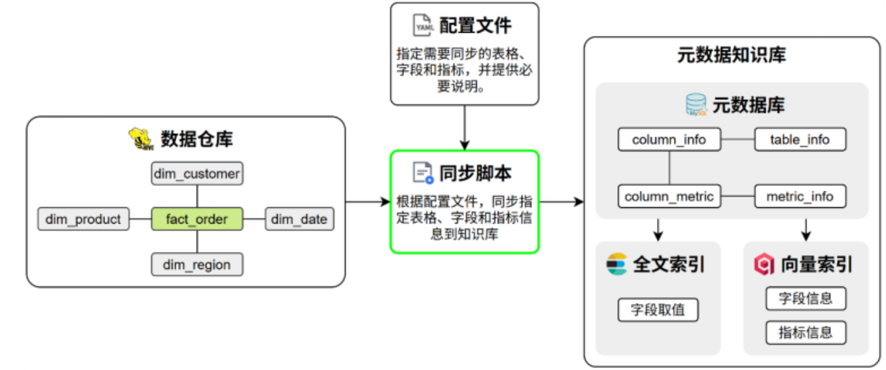

## 5.2 代码组织规划

构建元数据知识库模块的核心代码采用分层设计，具体组织结构如下：

```bash
ata-agent/
├── conf/
│   └── meta_config.yaml # 配置文件，用于指定待同步的表格和指标
└── app/
    ├── conf/
    │   └── meta_config.py # 用于定义meta_config.yaml的参数结构
    ├── scripts/
    │   └── build_meta_knowledge.py # 构建元数据知识库的入口脚本，负责解析命令行参数
    ├── services/
    │   └── meta_knowledge_service.py # 负责实现构建元数据知识库的核心逻辑
    ├── entities/
    │   ├── table_info.py # 用于定义表格信息的业务实体类
    │   ├── column_info.py # 用于定义字段信息的业务实体类
    │   ├── metric_info.py # 用于定义指标信息的业务实体类
    │   ├── column_metric.py # 用于定义字段指标关系的业务实体类
    │   └── value_info.py # 用于定义字段取值的业务实体类
    └── repositories/
        ├── mysql/
        │   ├── meta/
        │   │   ├── meta_mysql_repository.py # 负责实现meta数据库的读写操作
        │   │   └── mappers/
        │   │       ├── table_info_mapper.py # table_info orm实体和业务实体的类型转换
        │   │       ├── column_info_mapper.py # column_info orm实体和业务实体的类型转换
        │   │       ├── metric_info_mapper.py # metric_info orm实体和业务实体的类型转换
        │   │       └── column_metric_mapper.py # column_metric orm实体和业务实体的类型转换
        │   ├── dw/
        │   │   └── dw_mysql_repository.py # 负责实现dw数据库的读写操作
        ├── qdrant/
        │   ├── column_qdrant_repository.py # 负责实现qdrant中column相关集合的读写操作
        │   └── metric_qdrant_repository.py # 负责实现qdrant中metric相关集合的读写操作
        └── es/
            └── value_qdrant_repository.py # 用于定义es中value索引的实体类
```

## 5.3 具体实现

### 5.3.1 实体类

#### 业务实体类

业务实体类用于统一封装不同存储系统中的数据结构（如 Meta 数据库、Elasticsearch、Qdrant），作为应用上层组件进行读写操作时的标准参数类型和返回值类型。本项目定义的业务实体有：TableInfo、ColumnInfo、MetricInfo、ColumnMetric、ValueInfo，具体代码如下： 

- TableInfo（`data-agent/app/entities/table_info.py`）

  ```python
  from dataclasses import dataclass
  
  
  @dataclass
  class TableInfo:
      id: str
      name: str
      role: str
      description: str
  ```

- ColumnInfo（`data-agent/app/entities/column_info.py`）

  ```python
  from dataclasses import dataclass
  from typing import Any
  
  @dataclass
  class ColumnInfo:
    id: str
    name: str
    type: str
    role: str
    examples: list[Any]
    description: str
    alias: list[str]
    table_id: str
  ```

- MetricInfo（`data-agent/app/entities/metric_info.py`）

  ```python
  from dataclasses import dataclass
  
  @dataclass
  class MetricInfo:
    id: str
    name: str
    description: str
    relevant_columns: list[str]
    alias: list[str]
  ```

- ColumnMetric（`data-agent/app/entities/column_metric.py`）

  ```python
  from dataclasses import dataclass
  
  @dataclass
  class ColumnMetric:
    column_id: str
    metric_id: str
  
  ```

- ValueInfo（`data-agent/app/entities/value_info.py`）

  ```python
  from dataclasses import dataclass
  
  @dataclass
  class ValueInfo:
    id: str
    value: str
    column_id: str
  ```

#### Model模型

Python 类 ↔ 数据库表 的映射关系（类 = 表，实例 = 行，属性 = 列），用面向对象的方式操作数据库，无需编写原生 SQL（底层由 SQLAlchemy 自动转换）**官方术语**：`Declarative Model`（声明式模型），日常简化为 `Model`

- `data-agent/app/models/base.py`

  ```python
  from sqlalchemy.orm import DeclarativeBase
  
  class Base(DeclarativeBase):
      pass
  
  ```

- `data-agent/app/models/table_info_mysql.py`

  ```python
  from sqlalchemy import String, Text
  from sqlalchemy.orm import Mapped, mapped_column
  
  from app.models.base import Base
  
  
  class TableInfoMySQL(Base):
      __tablename__ = "table_info"
  
      id: Mapped[str] = mapped_column(
          String(64),
          primary_key=True,
          comment="表编号"
      )
      name: Mapped[str | None] = mapped_column(
          String(128),
          comment="表名称"
      )
      role: Mapped[str | None] = mapped_column(
          String(32),
          comment="表类型(fact/dim)"
      )
      description: Mapped[str | None] = mapped_column(
          Text,
          comment="表描述"
      )
  ```

- `data-agent/app/models/column_info_mysql.py`

  ```python
  from sqlalchemy import String, Text
  from sqlalchemy.types import JSON
  from sqlalchemy.orm import Mapped, mapped_column
  
  from app.models.base import Base
  
  
  class ColumnInfoMySQL(Base):
      __tablename__ = "column_info"
  
      id: Mapped[str] = mapped_column(
          String(64),
          primary_key=True,
          comment="列编号"
      )
      name: Mapped[str | None] = mapped_column(
          String(128),
          comment="列名称"
      )
      type: Mapped[str | None] = mapped_column(
          String(64),
          comment="数据类型"
      )
      role: Mapped[str | None] = mapped_column(
          String(32),
          comment="列类型(primary_key,foreign_key,measure,dimension)"
      )
      examples: Mapped[dict | list | None] = mapped_column(
          JSON,
          comment="数据示例"
      )
      description: Mapped[str | None] = mapped_column(
          Text,
          comment="列描述"
      )
      alias: Mapped[dict | list | None] = mapped_column(
          JSON,
          comment="列别名"
      )
      table_id: Mapped[str | None] = mapped_column(
          String(64),
          comment="所属表编号"
      )
  
  ```

- `data-agent/app/models/metric_info_mysql.py`

  ```python
  from sqlalchemy import String, Text
  from sqlalchemy.types import JSON
  from sqlalchemy.orm import Mapped, mapped_column
  
  from app.models.base import Base
  
  
  class MetricInfoMySQL(Base):
      __tablename__ = "metric_info"
  
      id: Mapped[str] = mapped_column(
          String(64),
          primary_key=True,
          comment="指标编码"
      )
      name: Mapped[str | None] = mapped_column(
          String(128),
          comment="指标名称"
      )
      description: Mapped[str | None] = mapped_column(
          Text,
          comment="指标描述"
      )
      relevant_columns: Mapped[dict | list | None] = mapped_column(
          JSON,
          comment="关联字段"
      )
      alias: Mapped[dict | list | None] = mapped_column(
          JSON,
          comment="指标别名"
      )
  
  ```

- `data-agent/app/models/column_metric_mysql.py`

  ```python
  from sqlalchemy import String
  from sqlalchemy.orm import Mapped, mapped_column
  
  from app.models.base import Base
  
  
  class ColumnMetricMySQL(Base):
      __tablename__ = "column_metric"
  
      column_id: Mapped[str] = mapped_column(
          String(64),
          primary_key=True,
          comment="列编号"
      )
      metric_id: Mapped[str] = mapped_column(
          String(64),
          primary_key=True,
          comment="指标编号"
      )
  ```

#### 实体转换类

在data-agent/app/repositories/mysql/meta/mappers包下定义如下Mapper类，用于SQLAlchemy模型实体类与对应的业务实体类之间的类型转换。

- TableInfoMapper （`data-agent/app/repositories/mysql/meta/mappers/table_info_mapper.py`）

  ```python
  from dataclasses import asdict
  
  from app.entities.table_info import TableInfo
  from app.models.table_info_mysql import TableInfoMySQL
  
  
  class TableInfoMapper:
      @staticmethod
      def to_entity(table_info_mysql: TableInfoMySQL) -> TableInfo:
          return TableInfo(
              id=table_info_mysql.id,
              name=table_info_mysql.name,
              role=table_info_mysql.role,
              description=table_info_mysql.description
          )
  
      @staticmethod
      def to_model(table_info: TableInfo) -> TableInfoMySQL:
          return TableInfoMySQL(**asdict(table_info))
  ```

- ColumnInfoMapper

（`data-agent/app/repositories/mysql/meta/mappers/column_info_mapper.py`）

```python
from dataclasses import asdict

from app.entities.column_info import ColumnInfo
from app.models.column_info_mysql import ColumnInfoMySQL


class ColumnInfoMapper:

    @staticmethod
    def to_entity(column_info_mysql:ColumnInfoMySQL) -> ColumnInfo:
        # 将持久层对象 转为 业务层对象 只能手动赋值
        return ColumnInfo(
            id=column_info_mysql.id,
            name=column_info_mysql.name,
            type=column_info_mysql.type,
            role=column_info_mysql.role,
            examples=column_info_mysql.examples,
            description=column_info_mysql.description,
            alias=column_info_mysql.alias,
            table_id=column_info_mysql.table_id,
        )
    @staticmethod
    def to_model(column_info:ColumnInfo) -> ColumnInfoMySQL:
        # 将业务层对象转为持久层对象
        return ColumnInfoMySQL(**asdict(column_info))
```

- MetricInfoMapper

  （`data-agent/app/repositories/mysql/meta/mappers/metric_info_mapper.py`）

  ```python
  from dataclasses import asdict
  
  from app.entities.metric_info import MetricInfo
  from app.models.metric_info_mysql import MetricInfoMySQL
  
  
  class MetricInfoMapper:
      @staticmethod
      def to_entity(model: MetricInfoMySQL) -> MetricInfo:
          return MetricInfo(
              id=model.id,
              name=model.name,
              description=model.description,
              relevant_columns=model.relevant_columns,
              alias=model.alias
          )
  
      @staticmethod
      def to_model(entity: MetricInfo):
          return MetricInfoMySQL(**asdict(entity))
  
  ```

  

- ColumnMetricMapper

  （`data-agent/app/repositories/mysql/meta/mappers/column_metric_mapper.py`）

  ```python
  from dataclasses import asdict
  
  from app.entities.column_metric import ColumnMetric
  from app.models.column_metric_mysql import ColumnMetricMySQL
  
  
  class ColumnMetricMapper:
      @staticmethod
      def to_entity(column_metric_mysql: ColumnMetricMySQL):
          return ColumnMetric(
              column_id=column_metric_mysql.column_id,
              metric_id=column_metric_mysql.metric_id
          )
  
      @staticmethod
      def to_model(column_metric: ColumnMetric):
          return ColumnMetricMySQL(**asdict(column_metric))
  
  ```


### 5.3.2 配置文件

#### 5.3.2.1 结构说明

配置文件采用yaml格式，用于指定待同步的表格和指标信息，其结构要求如下

```yaml
tables: # 表格信息
    - name: <table_name> # 真实表名
      role: dim | fact # 表角色
      description: <table_description> # 表的业务含义说明
      columns:
          - name: <column_name> # 真实字段名
            role: primary_key | foreign_key | dimension | measure # 字段角色 
            description: <column_description> # 字段的业务含义
            alias: [<alias1>, <alias2>] # 字段同义词
            sync: true | false # 该字段取值是否需要同步到ES建立全文索引

metrics: # 指标信息
    - name: <metric_name> # 指标名称，如 GMV、AOV
      description: <metric_description> # 指标的业务含义与计算口径说明
      relevant_columns: [<table_name.column_name>] # 指标相关字段
      alias: [<alias1>, <alias2>] # 指标同义词
```

#### 5.3.2.2 具体配置

当前的数据仓库模拟环境（dw库）中共有 5 张表和 2 个指标需要同步到元数据知识库，具体配置如下。

**说明：**该配置文件应由脚本调用方提供，所以该文件在项目中的路径不做要求，现暂将其置于`data-agent/conf/meta_config.yaml`中。

```yaml
tables:
  - name: dim_region
    role: dim
    description: 地区维度表，用于描述订单发生的地理区域信息。
    columns:
      - name: region_id
        role: primary_key
        description: 地区唯一标识。
        alias: [ 地区ID, 区域ID ]
        sync: false

      - name: province
        role: dimension
        description: 订单所属的省份名称。
        alias: [ 省份, 省, 所在省份 ]
        sync: true

      - name: region_name
        role: dimension
        description: 订单所属的大区名称，如华东、华南等。
        alias: [ 地区, 区域, 大区 ]
        sync: true

      - name: country
        role: dimension
        description: 地区所属国家名称。
        alias: [ 国家, 国家名称 ]
        sync: true


  - name: dim_customer
    role: dim
    description: 客户维度表，描述下单客户的基本属性。
    columns:
      - name: customer_id
        role: primary_key
        description: 客户唯一标识。
        alias: [ 客户ID, 用户ID ]
        sync: false

      - name: customer_name
        role: dimension
        description: 客户名称。
        alias: [ 客户名称, 用户名称 ]
        sync: true

      - name: gender
        role: dimension
        description: 客户性别。
        alias: [ 性别 ]
        sync: true

      - name: member_level
        role: dimension
        description: 客户会员等级。
        alias: [ 会员等级, 用户等级 ]
        sync: true


  - name: dim_product
    role: dim
    description: 商品维度表，描述商品的基本属性信息。
    columns:
      - name: product_id
        role: primary_key
        description: 商品唯一标识。
        alias: [ 商品ID, 产品ID ]
        sync: false

      - name: product_name
        role: dimension
        description: 商品名称。
        alias: [ 商品名称, 产品名称 ]
        sync: true

      - name: category
        role: dimension
        description: 商品所属品类。
        alias: [ 商品类别, 品类, 分类 ]
        sync: true

      - name: brand
        role: dimension
        description: 商品品牌名称。
        alias: [ 品牌, 品牌名称 ]
        sync: true


  - name: dim_date
    role: dim
    description: 时间维度表，用于多时间粒度分析。
    columns:
      - name: date_id
        role: primary_key
        description: 日期唯一标识，格式 yyyyMMdd。
        alias: [ 日期ID, 日期 ]
        sync: false

      - name: year
        role: dimension
        description: 年份。
        alias: [ 年, 年份 ]
        sync: false

      - name: quarter
        role: dimension
        description: 季度。
        alias: [ 季度 ]
        sync: true

      - name: month
        role: dimension
        description: 月份。
        alias: [ 月, 月份 ]
        sync: false

      - name: day
        role: dimension
        description: 日。
        alias: [ 日, 天 ]
        sync: false

  - name: fact_order
    role: fact
    description: 订单事实表，记录订单数量和金额等核心指标。
    columns:
      - name: order_id
        role: primary_key
        description: 订单唯一标识。
        alias: [ 订单ID ]
        sync: false

      - name: customer_id
        role: foreign_key
        description: 关联客户维度的外键。
        alias: [ 客户ID, 用户ID ]
        sync: false

      - name: product_id
        role: foreign_key
        description: 关联商品维度的外键。
        alias: [ 商品ID, 产品ID ]
        sync: false

      - name: date_id
        role: foreign_key
        description: 关联时间维度的外键。
        alias: [ 日期, 下单日期 ]
        sync: false

      - name: region_id
        role: foreign_key
        description: 关联地区维度的外键。
        alias: [ 地区ID, 区域ID ]
        sync: false

      - name: order_quantity
        role: measure
        description: 订单中商品的购买数量。
        alias: [ 销量, 购买数量, 件数 ]
        sync: false

      - name: order_amount
        role: measure
        description: 订单金额。
        alias: [ 销售额, 订单金额, 收入 ]
        sync: false


metrics:
  - name: GMV
    description: 全称Gross Merchandise Value，表示所有订单的成交金额总和。
    relevant_columns:
      - fact_order.order_amount
    alias: [ 成交总额, 订单总额 ]
  - name: AOV
    description: 全称Average Order Value，表示所有订单的成交金额平均值。
    relevant_columns:
      - fact_order.order_quantity
    alias: [ 平均单价, 平均订单金额 ]
  - name: ORDER_COUNT
    description: 统计周期内的订单总数量，按order_id去重计数。
    relevant_columns:
      - fact_order.order_id
    alias: [ 订单数, 下单量 ]
  - name: ORDER_COUNT_BY_REGION
    description: 按地区维度（region_id/region_name）统计的订单数量。
    relevant_columns:
      - fact_order.order_id
      - dim_region.region_id
      - dim_region.region_name
    alias: [ 区域订单量, 各地区下单数 ]
  - name: SALES_QUANTITY
    description: 统计周期内所有订单的商品购买数量总和。
    relevant_columns:
      - fact_order.order_quantity
    alias: [ 总销量, 销售件数 ]
  - name: SALES_QUANTITY_BY_CATEGORY
    description: 按商品品类（category）统计的商品销售数量。
    relevant_columns:
      - fact_order.order_quantity
      - dim_product.category
    alias: [ 品类销售件数, 分类销量 ]
  - name: AVG_ORDER_QUANTITY
    description: 订单商品购买数量的平均值（总销量/订单总数）。
    relevant_columns:
      - fact_order.order_quantity
      - fact_order.order_id
    alias: [ 单均商品数, 平均购买件数 ]
  - name: AVG_AMOUNT_BY_CUSTOMER
    description: 统计周期内客户的平均订单金额（GMV/客户数）。
    relevant_columns:
      - fact_order.order_amount
      - fact_order.customer_id
    alias: [ 客均消费, 客户平均下单金额 ]
  - name: GMV_BY_MEMBER_LEVEL
    description: 按客户会员等级（member_level）统计的成交总额。
    relevant_columns:
      - fact_order.order_amount
      - dim_customer.member_level
    alias: [ 会员等级销售额, 各等级成交总额 ]
  - name: DAILY_GMV
    description: 按日期维度（date_id/year/month/day）统计的每日GMV。
    relevant_columns:
      - fact_order.order_amount
      - dim_date.date_id
      - dim_date.year
      - dim_date.month
      - dim_date.day
    alias: [ 日GMV, 每日成交总额 ]
  - name: QUARTERLY_SALES
    description: 按季度（quarter）统计的商品销售总量。
    relevant_columns:
      - fact_order.order_quantity
      - dim_date.quarter
    alias: [ 季度销售件数, 季度销量 ]
  - name: GMV_BY_BRAND
    description: 按商品品牌（brand）统计的成交总额。
    relevant_columns:
      - fact_order.order_amount
      - dim_product.brand
    alias: [ 品牌GMV, 各品牌销售额 ]
  - name: TOP_PRODUCT_SALES
    description: 按商品名称（product_name）排序的商品销售数量TOP榜。
    relevant_columns:
      - fact_order.order_quantity
      - dim_product.product_id
      - dim_product.product_name
    alias: [ 商品销量TOP, 热销商品件数 ]
  - name: CUSTOMER_COUNT
    description: 统计周期内下单的客户总数量，按customer_id去重计数。
    relevant_columns:
      - fact_order.customer_id
    alias: [ 下单客户数, 客户数量 ]
  - name: CUSTOMER_COUNT_BY_GENDER
    description: 按客户性别（gender）统计的下单客户数量。
    relevant_columns:
      - fact_order.customer_id
      - dim_customer.gender
    alias: [ 性别客户数, 男女下单人数 ]
  - name: MEMBER_LEVEL_COUNT
    description: 按会员等级（member_level）统计的下单客户数量。
    relevant_columns:
      - fact_order.customer_id
      - dim_customer.member_level
    alias: [ 会员等级客户数, 各等级下单人数 ]
```

### 5.3.3 结构定义

在`data-agent/app/conf/meta_config.py`中编写如下内容，用于定义上述配置参数的结构。

```python
from dataclasses import dataclass
from typing import Optional


@dataclass
class ColumnConfig:
    name: str
    role: str
    description: str
    alias: list[str]
    sync: bool


@dataclass
class TableConfig:
    name: str
    role: str
    description: str
    columns: list[ColumnConfig]


@dataclass
class MetricConfig:
    name: str
    description: str
    relevant_columns: list[str]
    alias: list[str]


@dataclass
class MetaConfig:
    tables: Optional[list[TableConfig]] = None
    metrics: Optional[list[MetricConfig]] = None

```

### 5.3.4 入口脚本

入口脚本（`data-agent/app/scripts/build_meta_knowledge.py`）主要负责解析调用者传入的配置文件路径。具体内容如下：

```python
import asyncio
from argparse import ArgumentParser
from pathlib import Path

from app.clients.embedding_client_manager import embedding_client_manager
from app.clients.es_client_manager import es_client_manager
from app.clients.mysql_client_manager import (
    meta_mysql_client_manager,
    dw_mysql_client_manager,
)
from app.clients.qdrant_client_manager import qdrant_client_manager
from app.repositories.qdrant.column_qdrant_repository import ColumnQdrantRepository
from app.repositories.mysql.dw.dw_mysql_repository import DWMySQLRepository
from app.repositories.mysql.meta.meta_mysql_repository import MetaMySQLRepository
from app.repositories.es.value_es_repository import ValueESRepository
from app.repositories.qdrant.metric_qdrant_repository import MetricQdrantRepository
from app.services.meta_knowledge_service import MetaKnowledgeService


async def build(config_path: Path):
    meta_mysql_client_manager.init()  # 初始化元数据MySQL客户端
    dw_mysql_client_manager.init()  # 初始化数据仓库MySQL客户端
    qdrant_client_manager.init()  # 初始化Qdrant客户端
    embedding_client_manager.init()  # 初始化Embedding客户端
    es_client_manager.init()  # 初始化Elasticsearch客户端

    async with (
        meta_mysql_client_manager.session_factory() as meta_session,
        dw_mysql_client_manager.session_factory() as dw_session,
    ):
        meta_mysql_repository = MetaMySQLRepository(
            meta_session
        )  # 创建元数据MySQLRepo实例
        dw_mysql_repository = DWMySQLRepository(dw_session)  # 创建数据仓库MySQLRepo实例
        column_qdrant_repository = ColumnQdrantRepository(
            qdrant_client_manager.client
        )  # 创建列QdrantRepo实例
        embedding_client = embedding_client_manager.client  # 获取Embedding客户端实例
        value_es_repository = ValueESRepository(
            es_client_manager.client
        )  # 创建值ElasticsearchRepo实例
        metric_qdrant_repository = MetricQdrantRepository(
            qdrant_client_manager.client
        )  # 创建指标QdrantRepo实例

        mete_knowledge_service = MetaKnowledgeService(
            meta_mysql_repository=meta_mysql_repository,
            dw_mysql_repository=dw_mysql_repository,
            column_qdrant_repository=column_qdrant_repository,
            embedding_client=embedding_client,
            value_es_repository=value_es_repository,
            metric_qdrant_repository=metric_qdrant_repository,
        )  # 创建MetaKnowledgeService实例
        await mete_knowledge_service.build(config_path)  # 构建元知识库

    await meta_mysql_client_manager.close()  # 关闭元数据MySQL客户端
    await dw_mysql_client_manager.close()  # 关闭数据仓库MySQL客户端
    await qdrant_client_manager.close()  # 关闭Qdrant客户端
    await es_client_manager.close()  # 关闭Elasticsearch客户端


if __name__ == "__main__":
    parser = ArgumentParser()

    parser.add_argument("-c", "--conf")  # option that takes a value

    args = parser.parse_args()

    config_path = Path(args.conf)

    asyncio.run(build(config_path))
```

### 5.3.5 核心业务逻辑

核心业务逻辑位于`data-agent/app/services/meta_knowledge_service.py`中，具体内容如下：

```python
import uuid
from pathlib import Path

from langchain_huggingface import HuggingFaceEndpointEmbeddings
from omegaconf import OmegaConf

from app.conf.meta_config import MetaConfig
from app.conf.logger import logger
from app.entities.column_info import ColumnInfo
from app.entities.column_metric import ColumnMetric
from app.entities.metric_info import MetricInfo
from app.entities.table_info import TableInfo
from app.entities.value_info import ValueInfo
from app.repositories.es.value_es_repository import ValueESRepository
from app.repositories.mysql.dw.dw_mysql_repository import DWMySQLRepository
from app.repositories.mysql.meta.meta_mysql_repository import MetaMySQLRepository
from app.repositories.qdrant.column_qdrant_repository import ColumnQdrantRepository
from app.repositories.qdrant.metric_qdrant_repository import MetricQdrantRepository


class MetaKnowledgeService:
    def __init__(
        self,
        meta_mysql_repository: MetaMySQLRepository,
        dw_mysql_repository: DWMySQLRepository,
        column_qdrant_repository: ColumnQdrantRepository,
        embedding_client: HuggingFaceEndpointEmbeddings,
        value_es_repository: ValueESRepository,
        metric_qdrant_repository: MetricQdrantRepository,
    ):
        self.meta_mysql_repository = meta_mysql_repository
        self.dw_mysql_repository = dw_mysql_repository
        self.column_qdrant_repository = column_qdrant_repository
        self.embedding_client = embedding_client
        self.value_es_repository = value_es_repository
        self.metric_qdrant_repository = metric_qdrant_repository

    async def _save_tables_to_meta_db(self, meta_config: MetaConfig)-> list[ColumnInfo]:
        table_infos: list[TableInfo] = []
        column_infos: list[ColumnInfo] = []

        for table in meta_config.tables:
            # 构造TableInfo实例
            table_info = TableInfo(
                id=table.name,
                name=table.name,
                role=table.role,
                description=table.description,
            )
            table_infos.append(table_info)

            # 查询该表的所有字段类型
            column_types: dict[str, str] = await self.dw_mysql_repository.get_column_types(table.name)
            for column in table.columns:
                # 查询该字段的部分取值作为示例
                column_values: list = await self.dw_mysql_repository.get_column_values(table.name, column.name, 10)
                # 构造ColumnInfo实例
                column_info = ColumnInfo(
                    id=f"{table.name}.{column.name}",
                    name=column.name,
                    type=column_types[column.name],
                    role=column.role,
                    examples=column_values,
                    description=column.description,
                    alias=column.alias,
                    table_id=table.name,
                )
                column_infos.append(column_info)

        # 保存表信息和字段信息到元数据数据库
        async with self.meta_mysql_repository.session.begin():
            await self.meta_mysql_repository.save_table_infos(table_infos)
            await self.meta_mysql_repository.save_column_infos(column_infos)

        return column_infos

    async def _save_column_info_to_qdrant(self, column_infos: list[ColumnInfo]):
        # 确保column_info的collection存在
        await self.column_qdrant_repository.ensure_collection()
        # 构造待保存的数据
        points: list[dict] = []
        for column_info in column_infos:
            points.append(
                {
                    "id": uuid.uuid4(),
                    "embedding_text": column_info.name,
                    "payload": column_info,
                }
            )
            points.append(
                {
                    "id": uuid.uuid4(),
                    "embedding_text": column_info.description,
                    "payload": column_info,
                }
            )
            for alia in column_info.alias:
                points.append(
                    {"id": uuid.uuid4(), "embedding_text": alia, "payload": column_info}
                )
        # 向量列表
        embedding_texts = [point["embedding_text"] for point in points]
        embedding_batch_size = 10
        embeddings = []
        for i in range(0, len(embedding_texts), embedding_batch_size):
            batch_embedding_texts = embedding_texts[i : i + embedding_batch_size]
            batch_embeddings = await self.embedding_client.aembed_documents(
                batch_embedding_texts
            )
            embeddings.extend(batch_embeddings)

        # id列表
        ids = [point["id"] for point in points]

        # payload列表
        payloads = [point["payload"] for point in points]

        # 保存数据到qdrant
        await self.column_qdrant_repository.upsert(ids, embeddings, payloads)

    async def _save_value_info_to_es(
        self, meta_config: MetaConfig, column_infos: list[ColumnInfo]
    ):
        # 确保index存在
        await self.value_es_repository.ensure_index()
        
        # 获取需要同步取值的列
        column2sync: dict[str, bool] = {}
        for table in meta_config.tables:
            for column in table.columns:
                column2sync[f"{table.name}.{column.name}"] = column.sync

        # 构造ValueInfo列表
        value_infos: list[ValueInfo] = []
        for column_info in column_infos:
            sync = column2sync[column_info.id]
            if sync:
                # 查询这个列的所有取值
                table_name = column_info.table_id
                column_name = column_info.name
                values = await self.dw_mysql_repository.get_column_values(
                    table_name, column_name, 100000
                )
                current_value_infos = [
                    ValueInfo(
                        id=f"{column_info.id}.{value}",
                        value=value,
                        column_id=column_info.id,
                    )
                    for value in values
                ]
                value_infos.extend(current_value_infos)
        # 批量保存到Elasticsearch
        await self.value_es_repository.index(value_infos)

    async def _save_metrics_to_meta_db(self, meta_config):
        metric_infos: list[MetricInfo] = []
        column_metrics: list[ColumnMetric] = []
        for metric in meta_config.metrics:
            # 构造MetricInfo数据
            metric_info = MetricInfo(
                id=metric.name,
                name=metric.name,
                description=metric.description,
                relevant_columns=metric.relevant_columns,
                alias=metric.alias,
            )
            metric_infos.append(metric_info)

            for relevant_column in metric.relevant_columns:
                # 构造ColumnMetric数据
                column_metric = ColumnMetric(
                    column_id=relevant_column, metric_id=metric.name
                )
                column_metrics.append(column_metric)
        # 保存到元数据数据库
        async with self.meta_mysql_repository.session.begin():
            await self.meta_mysql_repository.save_metric_infos(metric_infos)
            await self.meta_mysql_repository.save_column_metrics(column_metrics)

        return metric_infos

    async def _save_metric_info_to_qdrant(self, metric_infos: list[MetricInfo]):
        # 确保collection存在
        await self.metric_qdrant_repository.ensure_collection()
        
        # 构造待保存的数据
        points: list[dict] = []
        for metric_info in metric_infos:
            points.append(
                {
                    "id": uuid.uuid4(),
                    "embedding_text": metric_info.name,
                    "payload": metric_info,
                }
            )
            points.append(
                {
                    "id": uuid.uuid4(),
                    "embedding_text": metric_info.description,
                    "payload": metric_info,
                }
            )
            for alia in metric_info.alias:
                points.append(
                    {"id": uuid.uuid4(), "embedding_text": alia, "payload": metric_info}
                )

        ids = [point["id"] for point in points]
        embeddings = []
        embedding_texts = [point["embedding_text"] for point in points]
        embedding_batch_size = 10
        for i in range(0, len(embedding_texts), embedding_batch_size):
            batch_embedding_texts = embedding_texts[i : i + embedding_batch_size]
            batch_embeddings = await self.embedding_client.aembed_documents(
                batch_embedding_texts
            )
            embeddings.extend(batch_embeddings)
        payloads = [point["payload"] for point in points]

        # 保存数据到qdrant
        await self.metric_qdrant_repository.upsert(ids, embeddings, payloads)

    async def build(self, config_path: Path):
        # 1.加载配置文件
        context = OmegaConf.load(config_path)
        schema = OmegaConf.structured(MetaConfig)
        meta_config: MetaConfig = OmegaConf.to_object(OmegaConf.merge(schema, context))
        logger.info("加载配置文件")
        # 2.处理表信息
        if meta_config.tables:
            # 2.1 保存表信息到meta数据库
            column_infos = await self._save_tables_to_meta_db(meta_config)
            logger.info("保存表信息到meta数据库")

            # 2.2 为字段信息建立向量索引
            await self._save_column_info_to_qdrant(column_infos)
            logger.info("为字段信息建立向量索引")

            # 2.3 为字段取值建立全文索引
            await self._save_value_info_to_es(meta_config, column_infos)
            logger.info("为字段取值建立全文索引")

        # 3.处理指标信息
        if meta_config.metrics:
            # 3.1 保存指标信息到meta数据库
            metric_infos = await self._save_metrics_to_meta_db(meta_config)
            logger.info("保存指标信息到meta数据库")

            # 3.2 为指标信息建立向量索引
            await self._save_metric_info_to_qdrant(metric_infos)
            logger.info("为指标信息建立向量索引")

        logger.info("元数据知识库构建完成")
```

### 5.3.6 **数据**读写操作

#### 5.3.6.1 meta_mysql_repository

meta_mysql_repository用于实现meta数据库的读写操作，具体代码如下：

**1）**读写操作

在`data-agent/app/repositories/mysql/meta/meta_mysql_repository.py`中编写如下代码：

```python
from sqlalchemy import text
from sqlalchemy.ext.asyncio import AsyncSession

from app.entities.column_info import ColumnInfo
from app.entities.column_metric import ColumnMetric
from app.entities.metric_info import MetricInfo
from app.entities.table_info import TableInfo
from app.models.column_info_mysql import ColumnInfoMySQL
from app.models.table_info_mysql import TableInfoMySQL
from app.repositories.mysql.meta.mappers.column_info_mapper import ColumnInfoMapper
from app.repositories.mysql.meta.mappers.column_metric_mapper import ColumnMetricMapper
from app.repositories.mysql.meta.mappers.metric_info_mapper import MetricInfoMapper
from app.repositories.mysql.meta.mappers.table_info_mapper import TableInfoMapper


class MetaMySQLRepository:
    def __init__(self, session: AsyncSession):
        self.session = session

    async def save_table_infos(self, table_infos: list[TableInfo]):
        models = [TableInfoMapper.to_model(table_info) for table_info in table_infos]
        self.session.add_all(models)

    async def save_column_infos(self, columns_info: list[ColumnInfo]):
        models = [ColumnInfoMapper.to_model(column_info) for column_info in columns_info]
        self.session.add_all(models)

    async def save_metric_infos(self, metric_infos: list[MetricInfo]):
        self.session.add_all([MetricInfoMapper.to_model(metric_info) for metric_info in metric_infos])

    async def save_column_metrics(self, column_metrics: list[ColumnMetric]):
        self.session.add_all([ColumnMetricMapper.to_model(column_metric) for column_metric in column_metrics])

    async def get_column_info_by_id(self, column_id: str) -> ColumnInfo | None:
        result: ColumnInfoMySQL | None = await self.session.get(ColumnInfoMySQL, column_id)
        if result:
            return ColumnInfoMapper.to_entity(result)
        return None

    async def get_table_info_by_id(self, table_id: str) -> TableInfo | None:
        result: TableInfoMySQL | None = await self.session.get(TableInfoMySQL, table_id)
        if result:
            return TableInfoMapper.to_entity(result)
        return None

    async def get_key_columns_by_table_id(self, table_id: str) -> list[ColumnInfo]:
        sql = """
            select * 
            from column_info 
            where table_id = :table_id 
            and role in ('primary_key', 'foreign_key')
        """
        result = await self.session.execute(text(sql), {"table_id": table_id})
        return [ColumnInfo(**row) for row in result.mappings().fetchall()]

```

#### 5.3.4.2 dw_mysql_repository

dw_mysql_repository用于实现模拟数据仓库（dw库）的读写操作。

在`data-agent/app/repositories/mysql/dw/dw_mysql_repository.py`中编写如下代码：

```python
from sqlalchemy import text
from sqlalchemy.ext.asyncio import AsyncSession


class DWMySQLRepository:
    def __init__(self, session: AsyncSession):
        self.session = session

    async def get_column_types(self, table_name: str) -> dict[str, str]:
        sql = f"show columns from {table_name}"
        result = await self.session.execute(text(sql))
        return {row.Field: row.Type for row in result.fetchall()}

    async def get_column_values(self, table_name: str, column_name: str, limit: int):
        sql = f"select distinct {column_name} from {table_name} limit {limit}"
        result = await self.session.execute(text(sql))
        return result.scalars().fetchall()

    async def get_db_info(self):
        result = await self.session.execute(text("select version()"))
        version = result.scalar()

        dialect = self.session.get_bind().dialect.name

        return {'version': version, 'dialect': dialect}

    async def validate_sql(self, sql):
        await self.session.execute(text(f"explain {sql}"))

    async def execute_sql(self, sql):
        result = await self.session.execute(text(sql))
        return [dict(row) for row in result.mappings().fetchall()]

```

#### 5.3.4.3 column_qdrant_repository

column_qdrant_repository用于实现qdrant中的column_info集合的读写操作。

在`data-agent/app/repositories/qdrant/column_qdrant_repository.py`中编写如下代码：

```python
from dataclasses import asdict

from qdrant_client import AsyncQdrantClient
from qdrant_client.models import VectorParams, Distance, PointStruct

from app.conf.app_config import app_config
from app.entities.column_info import ColumnInfo


class ColumnQdrantRepository:
    collection_name: str = 'data-agent-column'

    def __init__(self, client: AsyncQdrantClient):
        self.client = client

    async def ensure_collection(self):
        if not await self.client.collection_exists(self.collection_name):
            await self.client.create_collection(self.collection_name,
                                                vectors_config=VectorParams(size=app_config.qdrant.embedding_size,
                                                                            distance=Distance.COSINE))

    async def upsert(self, ids: list[str], embeddings: list[list[float]], payloads: list[ColumnInfo],
                     batch_size: int = 20):
        zipped = list(zip(ids, embeddings, payloads))
        for i in range(0, len(zipped), batch_size):
            batch = zipped[i:i + batch_size]
            batch_points = [PointStruct(id=id, vector=embedding, payload=asdict(payload)) for id, embedding, payload in
                            batch]
            await self.client.upsert(collection_name=self.collection_name, points=batch_points)
```

#### 5.3.4.4 metric_qdrant_repository

metric_qdrant_repository用于实现qdrant中的metric_info集合的读写操作。

在`data-agent/app/repositories/qdrant/metric_qdrant_repository.py`中编写如下代码：

```python
from dataclasses import asdict

from qdrant_client import AsyncQdrantClient
from qdrant_client.models import VectorParams, Distance, PointStruct

from app.conf.app_config import app_config
from app.entities.metric_info import MetricInfo


class MetricQdrantRepository:
    collection_name = 'data-agent-metric'

    def __init__(self, client: AsyncQdrantClient):
        self.client = client

    async def ensure_collection(self):
        if not await self.client.collection_exists(self.collection_name):
            await self.client.create_collection(self.collection_name,
                                                vectors_config=VectorParams(size=app_config.qdrant.embedding_size,
                                                                            distance=Distance.COSINE))

    async def upsert(self, ids: list[str], embeddings: list[list[float]], payloads: list[MetricInfo],
                     batch_size: int = 20):
        zipped = list(zip(ids, embeddings, payloads))
        for i in range(0, len(zipped), batch_size):
            batch = zipped[i:i + batch_size]
            batch_points = [PointStruct(id=id, vector=embedding, payload=asdict(payload)) for id, embedding, payload in
                            batch]
            await self.client.upsert(collection_name=self.collection_name, points=batch_points)
```

#### 5.3.4.5 value_es_repository

value_es_repository用于实现es中的value_info index的读写操作。

在`data-agent/app/repositories/es/value_es_repository.py`中编写如下代码：

```python
from dataclasses import asdict

from elasticsearch import AsyncElasticsearch

from app.entities.value_info import ValueInfo


class ValueESRepository:
    index_name = 'data-agent-value'
    index_mappings = {
        "dynamic": False,
        "properties": {
            "id": {"type": "keyword"},
            "value": {"type": "text", "analyzer": "ik_max_word", "search_analyzer": "ik_max_word"},
            "column_id": {"type": "keyword"}
        }
    }

    def __init__(self, client: AsyncElasticsearch):
        self.client = client

    async def ensure_index(self):
        if not await self.client.indices.exists(index=self.index_name):
            await self.client.indices.create(index=self.index_name, mappings=self.index_mappings)

    async def index(self, value_infos: list[ValueInfo], batch_size=20):
        for i in range(0, len(value_infos), batch_size):
            batch = value_infos[i:i + batch_size]
            operations = []
            for value_info in batch:
                operations.append({"index": {"_index": self.index_name, "_id": value_info.id}})
                operations.append(asdict(value_info))
            await self.client.bulk(operations=operations)


```

## 5.4 测试

在终端执行如下命令执行build脚本

```bash
PS D:\code\workspace-python\data-agent> D:\develop\python\anaconda3\envs\python310\python.exe -m app.scripts.build_meta_knowledge --conf D:\code\workspace-python\data-agent\conf\meta_config.yaml
```

或者在idea开发工具中执行：**tips 需要要设置配置文件路径**

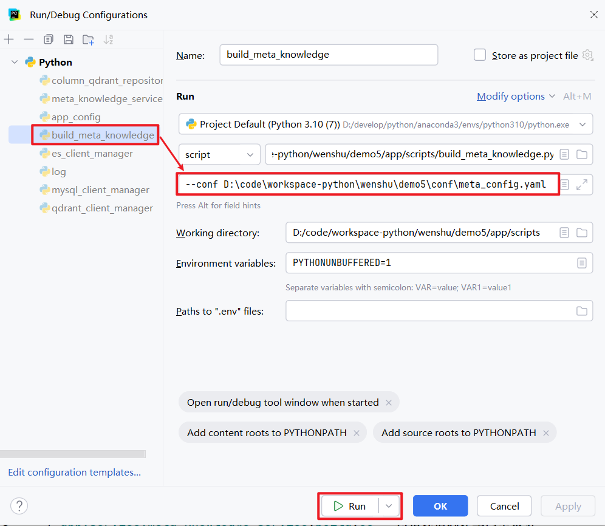

执行完毕后，可查看meta数据库、es和qdrant中是否有数据写入。

# 6. 问数智能体


## 6.1 需求说明

本章旨在实现问数智能体的工作流，工作流的编排以及各节点的职责可参考[前文2.4节](#问数智能体)。另外，为保证将来前端有一个较好的用户体验，工作流需要实时的输出执行进度和查询结果。

工作流的流式输出可参考[langgraph](https://docs.langchain.com/oss/python/langgraph/streaming)官网，本项目与前端约定的具体格式如下：

**执行进度：**

-  节点开始执行

  ```json
  {
      "type": "progress",
      "step": "召回字段",
      "status": "running"
  }
  ```

-  节点执行成功

  ```json
  {
      "type": "progress",
      "step": "召回字段",
      "status": "success"
  }
  ```

-  节点执行失败

  ```json
  {
      "type": "progress",
      "step": "召回字段",
      "status": "error"
  }
  ```

**查询结果：**

```json
{
    "type": "result",
    "data": [
        {
            "region_name": "华北",
            "order_amount": 1000
        },
        {
            "region_name": "华东",
            "order_amount": 2000
        },
        {
            "region_name": "华南",
            "order_amount": 3000
        }
    ]
}
```

**错误信息：**

```json
{
    "type": "error",
    "message": "数据查询失败，数据库连接超时"
}
```

## 6.2 代码组织规划

问数智能体的核心代码主要位于 data-agent/app/agent 目录下。

在智能体执行过程中，部分节点需要访问元数据或向量/检索系统以获取辅助信息，相关的查询与访问逻辑统一封装在 data-agent/app/repositories 目录中，供各个 Agent 节点按需调用。

除代码逻辑外，智能体运行还高度依赖提示词（Prompt）。所有提示词均集中管理在data-agent/prompts目录下。具体组织规划如下：

```bash
data-agent/
├─ app/
│  ├─ agent/
│  │  ├─ graph.py # 负责定义langgraph图
│  │  ├─ state.py # 负责定义langgraph状态
│  │  ├─ context.py # 负责定义langgraph运行上下文
│  │  ├─ llm.py # 负责定义llm
│  │  └─ nodes/
│  │     ├─ extract_keywords.py # 负责定义关键词抽取的节点
│  │     ├─ recall_column.py # 负责定义召回字段信息的节点
│  │     ├─ recall_metric.py # 负责定义召回指标信息的节点
│  │     ├─ recall_value.py  # 负责定义召回字段取值的节点
│  │     ├─ merge_retrieved_info.py # 负责定义合并召回信息的节点
│  │     ├─ filter_metric.py # 负责定义过滤指标信息的节点
│  │     ├─ filter_table.py # 负责定义过滤表格信息的节点
│  │     ├─ add_extra_context.py # 负责定义添加额外上下文信息的节点
│  │     ├─ generate_sql.py # 负责定义生成SQL的节点
│  │     ├─ validate_sql.py # 负责定义校验SQL的节点
│  │     ├─ correct_sql.py # 负责定义校正SQL的节点
│  │     └─ execute_sql.py # 负责定义执行SQL的节点
│  │
│  └─ repositories/
│     ├─ mysql/
│     │  ├─ meta/
│     │  │  ├─ meta_mysql_repository.py
│     │  │  └─ mappers/
│     │  │     ├─ table_info_mapper.py
│     │  │     ├─ column_info_mapper.py
│     │  │     ├─ metric_info_mapper.py
│     │  │     └─ column_metric_mapper.py
│     │  └─ dw/
│     │     └─ dw_mysql_repository.py
│     │
│     ├─ qdrant/
│     │  ├─ column_qdrant_repository.py
│     │  └─ metric_qdrant_repository.py
│     │
│     └─ es/
│        └─ value_qdrant_repository.py
│
├─ prompts/
│  ├─ extend_keywords_for_column_recall.prompt # 为召回字段信息扩展关键词 的提示词
│  ├─ extend_keywords_for_metric_recall.prompt # 为召回指标信息扩展关键词 的提示词
│  ├─ extend_keywords_for_value_recall.prompt # 为召回字段取值扩展关键词 的提示词 
│  ├─ filter_metric_info.prompt # 过滤指标信息 的提示词
│  ├─ filter_table_info.prompt # 过滤表格信息 的提示词
│  ├─ generate_sql.prompt # 生成SQL 的提示词
│  └─ correct_sql.prompt # 校正SQL 的提示词
│
└─ prompt/
   └─ prompt_loader.py
```

## 6.3 具体实现

### 6.3.1 prompts

#### 6.3.1.1 提示词

提示词可从课程资料获取，此处不再展示。新建`data-agent/prompts`目录用于存放提示词文件

#### 6.1.1.2 提示词加载

在`data-agent/app/prompt/prompt_loader.py`中编写如下代码，用于加载提示词：

```python
from pathlib import Path


def load_prompt(name: str) -> str:
    prompt_path = Path(__file__).parents[2] / 'prompts' / f'{name}.prompt'
    return prompt_path.read_text(encoding='utf-8')

```

### 6.3.2 llm

在`data-agent/app/agent/llm.py`中编写如下代码，用于定义llm：

```python
from langchain.chat_models import init_chat_model

from app.conf.app_config import app_config

llm = init_chat_model(model=app_config.llm.model_name,
                      model_provider="openai",
                      api_key=app_config.llm.api_key,
                      base_url=app_config.llm.base_url,
                      temperature=0)


if __name__ == '__main__':
    for chunk in llm.stream("简短介绍下自己"):
        print(chunk.text, end="", flush=True)

```

### 6.3.3 state

在`data-agent/app/agent/state.py`中编写如下代码，用于定义智能体状态：

```python
from typing import TypedDict

from app.entities.column_info import ColumnInfo
from app.entities.metric_info import MetricInfo
from app.entities.value_info import ValueInfo


class ColumnInfoState(TypedDict):
    name: str
    type: str
    role: str
    examples: list
    description: str
    alias: list[str]


class TableInfoState(TypedDict):
    name: str
    role: str
    description: str
    columns: list[ColumnInfoState]


class MetricInfoState(TypedDict):
    name: str
    description: str
    relevant_columns: list[str]
    alias: list[str]


class DateInfoState(TypedDict):
    date: str
    weekday: str
    quarter: str


class DBInfoState(TypedDict):
    dialect: str
    version: str


class DataAgentState(TypedDict):
    query: str  # 用户查询
    keywords: list[str]  # 用户查询的关键字

    retrieved_columns: list[ColumnInfo]  # 召回的字段信息
    retrieved_values: list[ValueInfo]  # 召回的值信息
    retrieved_metrics: list[MetricInfo]  # 召回的指标信息

    table_infos: list[TableInfoState]  # 表信息
    metric_infos: list[MetricInfoState]  # 指标信息

    date_info: DateInfoState  # 日期信息
    db_info: DBInfoState  # 数据库信息

    sql: str  # 生成的SQL

    error: str  # 验证SQL时的错误信息

```

### 6.3.4 context

在`data-agent/app/agent/context.py`中编写如下代码，用于定义智能体运行时所需的上下文依赖：

```python
from typing import TypedDict

from langchain_huggingface import HuggingFaceEndpointEmbeddings

from app.repositories.es.value_es_repository import ValueESRepository
from app.repositories.mysql.dw.dw_mysql_repository import DWMySQLRepository
from app.repositories.mysql.meta.meta_mysql_repository import MetaMySQLRepository
from app.repositories.qdrant.column_qdrant_repository import ColumnQdrantRepository
from app.repositories.qdrant.metric_qdrant_repository import MetricQdrantRepository


class DataAgentContext(TypedDict):
    embedding_client: HuggingFaceEndpointEmbeddings
    column_qdrant_repository: ColumnQdrantRepository
    value_es_repository: ValueESRepository
    metric_qdrant_repository: MetricQdrantRepository
    meta_mysql_repository: MetaMySQLRepository
    dw_mysql_repository: DWMySQLRepository

```

### 6.3.5 nodes

#### 6.3.5.1 extract_keywords

在`data-agent/app/agent/nodes/extract_keywords.py`中编写如下代码：

```python
import jieba.analyse
from langgraph.runtime import Runtime

from app.agent.context import DataAgentContext
from app.agent.state import DataAgentState
from app.conf.logger import logger


async def extract_keywords(state: DataAgentState, runtime: Runtime[DataAgentContext]):
    writer = runtime.stream_writer
    writer({"type": "progress", "step": "抽取关键字", "status": "running"})

    query = state["query"]

    # 对查询进行分词，只提取指定词性的词
    allow_pos = (
        "n",  # 名词: 数据、服务器、表格
        "nr",  # 人名: 张三、李四
        "ns",  # 地名: 北京、上海
        "nt",  # 机构团体名: 政府、学校、某公司
        "nz",  # 其他专有名词: Unicode、哈希算法、诺贝尔奖
        "v",  # 动词: 运行、开发
        "vn",  # 名动词: 工作、研究
        "a",  # 形容词: 美丽、快速
        "an",  # 名形词: 难度、合法性、复杂度
        "eng",  # 英文
        "i",  # 成语
        "l",  # 常用固定短语
    )

    keywords = jieba.analyse.extract_tags(query, allowPOS=allow_pos)

    keywords = list(set(keywords + [query]))

    writer({"type": "progress", "step": "抽取关键字", "status": "success"})
    logger.info(f"抽取关键字: {keywords}")
    return {"keywords": keywords}

```

#### 6.3.5.2 recall_column

在`data-agent/app/agent/nodes/recall_column.py`中编写如下代码：

```python
from langchain_core.output_parsers import JsonOutputParser
from langchain_core.prompts import PromptTemplate
from langgraph.runtime import Runtime

from app.agent.context import DataAgentContext
from app.agent.llm import llm
from app.agent.state import DataAgentState
from app.conf.logger import logger
from app.entities.column_info import ColumnInfo
from app.prompt.prompt_loader import load_prompt


async def recall_column(state: DataAgentState, runtime: Runtime[DataAgentContext]):
    writer = runtime.stream_writer
    writer({"type": "progress", "step": "召回字段", "status": "running"})

    query = state["query"]
    keywords = state["keywords"]

    embedding_client = runtime.context["embedding_client"]
    column_qdrant_repository = runtime.context["column_qdrant_repository"]

    try:
        # 使用LLM扩展关键词
        prompt = PromptTemplate(
            template=load_prompt("extend_keywords_for_column_recall"),
            input_variables=["query"],
        )
        output_parser = JsonOutputParser()

        chain = prompt | llm | output_parser

        result = await chain.ainvoke({"query": query})

        # 使用扩展后的关键词召回字段信息
        retrieved_columns_map: dict[str, ColumnInfo] = {}

        keywords = list(set(keywords + result))
        logger.info(f"召回字段信息扩展关键词：{keywords}")
        for keyword in keywords:
            embedding = await embedding_client.aembed_query(keyword)
            payloads: list[ColumnInfo] = await column_qdrant_repository.search(
                embedding
            )
            for payload in payloads:
                column_id = payload.id
                if column_id not in retrieved_columns_map:
                    retrieved_columns_map[column_id] = payload

        retrieved_columns = list(retrieved_columns_map.values())

        writer({"type": "progress", "step": "召回字段", "status": "success"})
        logger.info(f"召回字段信息：{list(retrieved_columns_map.keys())}")
        return {"retrieved_columns": retrieved_columns}
    except Exception as e:
        writer({"type": "progress", "step": "召回字段", "status": "error"})
        logger.error(f"召回字段信息失败: {str(e)}")
        raise

```

在`data-agent/app/repositories/qdrant/column_qdrant_repository.py`中添加如下方法：

```python
    async def search(self, embedding: list[float], score_threshold: float = 0.6, limit: int = 5) -> list[ColumnInfo]:
        result = await self.client.query_points(collection_name=self.collection_name,
                                                query=embedding,
                                                score_threshold=score_threshold,
                                                limit=limit)
        return [ColumnInfo(**point.payload) for point in result.points]
```


```mermaid

```

#### 6.3.5.3 recall_metric

**1）**在data-agent/app/agent/nodes/recall_metric.py中编写如下代码：

```python
from langchain_core.output_parsers import JsonOutputParser
from langchain_core.prompts import PromptTemplate
from langgraph.runtime import Runtime

from app.agent.context import DataAgentContext
from app.agent.llm import llm
from app.agent.state import DataAgentState
from app.conf.logger import logger
from app.entities.metric_info import MetricInfo
from app.prompt.prompt_loader import load_prompt


async def recall_metric(state: DataAgentState, runtime: Runtime[DataAgentContext]):
    writer = runtime.stream_writer
    writer({"type": "progress", "step": "召回指标", "status": "running"})

    query = state["query"]
    keywords = state["keywords"]

    embedding_client = runtime.context['embedding_client']
    metric_qdrant_repository = runtime.context['metric_qdrant_repository']

    try:
        # 使用LLM扩展关键词
        prompt = PromptTemplate(template=load_prompt("extend_keywords_for_metric_recall"), input_variables=["query"])
        output_parser = JsonOutputParser()

        chain = prompt | llm | output_parser

        result = await chain.ainvoke({"query": query})

        # 使用扩展后的关键词召回指标信息
        retrieved_metrics_map: dict[str, MetricInfo] = {}

        keywords = list(set(keywords + result))
        logger.info(f"召回指标信息扩展关键词：{keywords}")
        for keyword in keywords:
            embedding = await embedding_client.aembed_query(keyword)
            payloads: list[MetricInfo] = await metric_qdrant_repository.search(embedding)
            for payload in payloads:
                metric_id = payload.id
                if metric_id not in retrieved_metrics_map:
                    retrieved_metrics_map[metric_id] = payload

        retrieved_metrics = list(retrieved_metrics_map.values())

        writer({"type": "progress", "step": "召回指标", "status": "success"})
        logger.info(f"召回指标信息：{list(retrieved_metrics_map.keys())}")
        return {"retrieved_metrics": retrieved_metrics}
    except Exception as e:
        writer({"type": "progress", "step": "召回指标", "status": "error"})
        logger.error(f"召回指标信息失败: {str(e)}")
        raise

```

**2）**在data-agent/app/repositories/qdrant/metric_qdrant_repository.py中添加如下方法：

```python
    async def search(self, embedding: list[float], score_threshold: float = 0.6, limit: int = 5) -> list[MetricInfo]:
        result = await self.client.query_points(collection_name=self.collection_name,
                                                query=embedding,
                                                score_threshold=score_threshold,
                                                limit=limit)
        return [MetricInfo(**point.payload) for point in result.points]
```

#### 6.3.5.4 recall_value

**1）**在data-agent/app/agent/nodes/recall_value.py中编写如下代码：

```python
import asyncio

from langchain_core.output_parsers import JsonOutputParser
from langchain_core.prompts import PromptTemplate
from langgraph.runtime import Runtime

from app.agent.context import DataAgentContext
from app.agent.llm import llm
from app.agent.state import DataAgentState
from app.conf.logger import logger
from app.entities.value_info import ValueInfo
from app.prompt.prompt_loader import load_prompt


async def recall_value(state: DataAgentState, runtime: Runtime[DataAgentContext]):
    writer = runtime.stream_writer
    writer({"type": "progress", "step": "召回字段取值", "status": "running"})

    query = state["query"]
    keywords = state["keywords"]

    value_es_repository = runtime.context["value_es_repository"]

    try:
        # 使用LLM扩展关键词
        prompt = PromptTemplate(template=load_prompt("extend_keywords_for_value_recall"), input_variables=["query"])
        output_parser = JsonOutputParser()

        chain = prompt | llm | output_parser

        result = await chain.ainvoke({"query": query})

        # 使用扩展后的关键词召回字段取值
        values_map: dict[str, ValueInfo] = {}
        keywords = list(set(keywords + result))
        logger.info(f"召回字段取值扩展关键词：{keywords}")
        for keyword in keywords:
            values: list[ValueInfo] = await value_es_repository.search(keyword)
            for value in values:
                value_id = value.id
                if value_id not in values_map:
                    values_map[value_id] = value

        retrieved_values = list(values_map.values())

        writer({"type": "progress", "step": "召回字段取值", "status": "success"})
        logger.info(f"召回字段取值：{list(values_map.keys())}")

        return {'retrieved_values': retrieved_values}
    except Exception as e:
        writer({"type": "progress", "step": "召回字段取值", "status": "error"})
        logger.error(f"召回字段取值失败: {str(e)}")
        raise

```

**2）**在data-agent/app/repositories/es/value_es_repository.py中添加如下代码：

```python
    async def search(self, keyword: str, score_threshold: float = 0.6, limit: int = 5) -> list[ValueInfo]:
        result = await self.client.search(index=self.index_name,
                                          query={
                                              "match": {
                                                  "value": keyword
                                              }
                                          },
                                          min_score=score_threshold,
                                          size=limit)
        return [ValueInfo(**hit['_source']) for hit in result['hits']['hits']]
```

#### 6.3.5.5 merge_retrieved_info

**1）**在data-agent/app/agent/nodes/merge_retrieved_info.py中编写如下代码：

```python
from langgraph.runtime import Runtime

from app.agent.context import DataAgentContext
from app.agent.state import DataAgentState, TableInfoState, MetricInfoState, ColumnInfoState
from app.conf.logger import logger
from app.entities.column_info import ColumnInfo
from app.entities.table_info import TableInfo


async def merge_retrieved_info(state: DataAgentState, runtime: Runtime[DataAgentContext]):
    writer = runtime.stream_writer
    writer({"type": "progress", "step": "合并召回信息", "status": "running"})

    # 已召回信息
    retrieved_columns = state["retrieved_columns"]
    retrieved_values = state["retrieved_values"]
    retrieved_metrics = state["retrieved_metrics"]

    # 获取所需依赖
    meta_mysql_repository = runtime.context["meta_mysql_repository"]

    retrieved_columns_map: dict[str, ColumnInfo] = {retrieved_column.id: retrieved_column for retrieved_column
                                                    in retrieved_columns}

    # 合并表格信息
    table_infos: list[TableInfoState] = []

    try:
        # 将指标信息的相关字段加入字段信息列表
        for retrieved_metric in retrieved_metrics:
            relevant_columns = retrieved_metric.relevant_columns
            for relevant_column in relevant_columns:
                if relevant_column not in retrieved_columns_map:
                    column_info = await meta_mysql_repository.get_column_info_by_id(relevant_column)
                    retrieved_columns_map[relevant_column] = column_info

        # 将字段取值合并到字段信息列表
        for retrieved_value in retrieved_values:
            column_id = retrieved_value.column_id
            column_value = retrieved_value.value
            #
            if column_id not in retrieved_columns_map:
                column_info = await meta_mysql_repository.get_column_info_by_id(column_id)
                retrieved_columns_map[column_id] = column_info
            if column_value not in retrieved_columns_map[column_id].examples:
                retrieved_columns_map[column_id].examples.append(column_value)

        # 按照字段所属的表id进行分组，得到table_id->columns映射
        table_to_columns_map: dict[str, list[ColumnInfo]] = {}
        for column in retrieved_columns_map.values():
            table_id = column.table_id
            if table_id not in table_to_columns_map:
                table_to_columns_map[table_id] = []
            table_to_columns_map[table_id].append(column)

        # 显式的添加每个表的主外键
        for table_id in table_to_columns_map.keys():
            # 查询主外键字段
            key_columns: list[ColumnInfo] = await meta_mysql_repository.get_key_columns_by_table_id(table_id)

            # 当前表已有的所有列的ID
            column_ids = [column.id for column in table_to_columns_map[table_id]]

            for key_column in key_columns:
                if key_column.id not in column_ids:
                    table_to_columns_map[table_id].append(key_column)

        # 将table_id->columns映射 转换为 list[TableInfoState]
        for table_id, columns in table_to_columns_map.items():
            table: TableInfo = await  meta_mysql_repository.get_table_info_by_id(table_id)
            columns = [
                ColumnInfoState(name=column.name, type=column.type, role=column.role, examples=column.examples,
                                description=column.description, alias=column.alias)
                for column in columns]
            table_info_state = TableInfoState(name=table.name,
                                              role=table.role,
                                              description=table.description,
                                              columns=columns)
            table_infos.append(table_info_state)

        # 处理指标信息
        metric_infos: list[MetricInfoState] = [
            MetricInfoState(name=metric_info.name, description=metric_info.description,
                            relevant_columns=metric_info.relevant_columns, alias=metric_info.alias)
            for metric_info in retrieved_metrics]

        writer({"type": "progress", "step": "合并召回信息", "status": "success"})
        logger.info(
            f"合并召回信息: 表信息-{[table_info['name'] for table_info in table_infos]},指标信息-{[metric_info['name'] for metric_info in metric_infos]}")

        return {"table_infos": table_infos, "metric_infos": metric_infos}
    except Exception as e:
        writer({"type": "progress", "step": "合并召回信息", "status": "error"})
        logger.error(f"合并召回信息失败: {str(e)}")
        raise

```

**2）**在data-agent/app/repositories/mysql/meta/meta_mysql_repository.py中添加如下代码：

```python
    async def get_column_info_by_id(self, column_id: str) -> ColumnInfo:
        column_info_mysql: ColumnInfoMySQL | None = await self.session.get(ColumnInfoMySQL, column_id)
        return ColumnInfoMapper.to_entity(column_info_mysql)
    
    async def get_key_columns_by_table_id(self, table_id) ->list[ColumnInfo]:
        stmt = select(ColumnInfoMySQL).where(ColumnInfoMySQL.table_id == table_id, ColumnInfoMySQL.role.in_(["foreign_key","primary_key"]))
        result = await self.session.execute(stmt)
        return [ColumnInfoMapper.to_entity(column_info_mysql) for column_info_mysql in result.scalars().all()]   
    
    async def get_table_info_by_id(self, table_id: str) -> TableInfo:
        table_info_mysql: TableInfoMySQL | None = await self.session.get(TableInfoMySQL, table_id)
        return TableInfoMapper.to_entity(table_info_mysql)

```

#### 6.3.5.6 filter_table

在data-agent/app/agent/nodes/filter_table.py中编写如下代码：

```python
import yaml
from langchain_core.output_parsers import JsonOutputParser
from langchain_core.prompts import PromptTemplate
from langgraph.runtime import Runtime

from app.agent.context import DataAgentContext
from app.agent.llm import llm
from app.agent.state import DataAgentState
from app.conf.logger import logger
from app.prompt.prompt_loader import load_prompt


async def filter_table(state: DataAgentState, runtime: Runtime[DataAgentContext]):
    writer = runtime.stream_writer
    writer({"type": "progress", "step": "过滤表格", "status": "running"})

    query = state["query"]
    table_infos = state["table_infos"]

    try:
        # 用LLM过滤表信息
        prompt = PromptTemplate(template=load_prompt("filter_table_info"), input_variables=["query", "table_infos"])
        output_parser = JsonOutputParser()

        chain = prompt | llm | output_parser

        result = await chain.ainvoke(
            {"query": query, "table_infos": yaml.dump(table_infos, allow_unicode=True, sort_keys=False)})

        # 利用模型输出过滤table_infos
        # {
        #   'fact_order':['order_amount', 'region_id'],
        #   'dim_region':['region_id', 'region_name']
        # }
        for table_info in table_infos[:]:
            if table_info["name"] not in result:
                table_infos.remove(table_info)
            else:
                selected_columns = result[table_info["name"]]
                for column_info in table_info["columns"][:]:
                    if column_info["name"] not in selected_columns:
                        table_info["columns"].remove(column_info)

        writer({"type": "progress", "step": "过滤表格", "status": "success"})
        logger.info(f"过滤后的表信息: {[table_info['name'] for table_info in table_infos]}")
        return {"table_infos": table_infos}
    except Exception as e:
        writer({"type": "progress", "step": "过滤表格", "status": "error"})
        logger.error(f"过滤表失败:{str(e)}")
        raise

```


#### 6.3.5.7 filter_metric

在`data-agent/app/agent/nodes/filter_metric.py`中编写如下代码：

```python
import yaml
from langchain_core.output_parsers import JsonOutputParser
from langchain_core.prompts import PromptTemplate
from langgraph.runtime import Runtime

from app.agent.context import DataAgentContext
from app.agent.llm import llm
from app.agent.state import DataAgentState
from app.conf.logger import logger
from app.prompt.prompt_loader import load_prompt


async def filter_metric(state: DataAgentState, runtime: Runtime[DataAgentContext]):
    writer = runtime.stream_writer
    writer({"type": "progress", "step": "过滤指标", "status": "running"})

    query = state["query"]
    metric_infos = state["metric_infos"]
    try:
        # 用LLM过滤表信息
        prompt = PromptTemplate(template=load_prompt("filter_metric_info"), input_variables=["query", "metric_infos"])
        output_parser = JsonOutputParser()

        chain = prompt | llm | output_parser

        result = await chain.ainvoke(
            {"query": query, "metric_infos": yaml.dump(metric_infos, allow_unicode=True, sort_keys=False)})

        # 利用模型输出过滤metric_infos
        for metric_info in metric_infos[:]:
            if metric_info["name"] not in result:
                metric_infos.remove(metric_info)

        writer({"type": "progress", "step": "过滤指标", "status": "success"})
        logger.info(f"过滤后的指标: {[metric_info['name'] for metric_info in metric_infos]}")
        return {"metric_infos": metric_infos}
    except Exception as e:
        writer({"type": "progress", "step": "过滤指标", "status": "error"})
        logger.error(f"过滤指标失败:{str(e)}")
        raise

```

#### 6.3.5.8 add_extra_context

**1）**在data-agent/app/agent/nodes/add_extra_context.py中编写如下代码：

```python
from datetime import datetime

from langgraph.runtime import Runtime

from app.agent.context import DataAgentContext
from app.agent.state import DataAgentState, DateInfoState
from app.conf.logger import logger


async def add_extra_context(state: DataAgentState, runtime: Runtime[DataAgentContext]):
    writer = runtime.stream_writer
    writer({"type": "progress", "step": "添加额外上下文信息", "status": "running"})

    dw_mysql_repository = runtime.context["dw_mysql_repository"]

    try:
        # 当前的时间信息
        today = datetime.today()
        # 日期
        date = today.strftime("%Y-%m-%d")
        # 星期
        weekday = today.strftime("%A")
        # 季度
        quarter = f"Q{(today.month - 1) // 3 + 1}"

        date_info = DateInfoState(date=date, weekday=weekday, quarter=quarter)

        # 数据仓库环境信息
        db_info = await dw_mysql_repository.get_db_info()

        writer({"type": "progress", "step": "添加额外上下文信息", "status": "success"})
        logger.info(f"额外上下文信息：数据库信息-{db_info} 日期信息-{date_info}")
        return {
            "date_info": date_info,
            "db_info": db_info,
        }
    except Exception as e:
        writer({"type": "progress", "step": "添加额外上下文信息", "status": "error"})
        logger.error(f"添加上下文失败:{str(e)}")
        raise

```

**2）**在data-agent/app/repositories/mysql/dw/dw_mysql_repository.py中添加如下代码：

```python
    async def get_db_info(self):
        result = await self.session.execute(text("select version()"))
        version = result.scalar()

        dialect = self.session.get_bind().dialect.name

        return {'version': version, 'dialect': dialect}
```

#### 6.3.5.9 generate_sql

在`data-agent/app/agent/nodes/generate_sql.py`中编写如下代码：

```python
import yaml
from langchain_core.output_parsers import StrOutputParser
from langchain_core.prompts import PromptTemplate
from langgraph.runtime import Runtime

from app.agent.context import DataAgentContext
from app.agent.llm import llm
from app.agent.state import DataAgentState
from app.conf.logger import logger
from app.prompt.prompt_loader import load_prompt


async def generate_sql(state: DataAgentState, runtime: Runtime[DataAgentContext]):
    writer = runtime.stream_writer
    writer({"type": "progress", "step": "生成SQL", "status": "running"})

    query = state["query"]
    table_infos = state["table_infos"]
    metric_infos = state["metric_infos"]
    date_info = state["date_info"]
    db_info = state["db_info"]

    try:
        prompt = PromptTemplate(template=load_prompt("generate_sql"),
                                input_variables=["query", "table_infos", "metric_infos", "date_info", "db_info"])
        output_parser = StrOutputParser()

        chain = prompt | llm | output_parser

        result = await chain.ainvoke(
            {"query": query,
             "table_infos": yaml.dump(table_infos, allow_unicode=True, sort_keys=False),
             "metric_infos": yaml.dump(metric_infos, allow_unicode=True, sort_keys=False),
             "date_info": yaml.dump(date_info, allow_unicode=True, sort_keys=False),
             "db_info": yaml.dump(db_info, allow_unicode=True, sort_keys=False)
             })

        writer({"type": "progress", "step": "生成SQL", "status": "success"})
        logger.info(f"生成的SQL: {result}")
        return {"sql": result}
    except Exception as e:
        writer({"type": "progress", "step": "生成SQL", "status": "error"})
        logger.error(f"生成SQL失败: {str(e)}")
        raise
```

#### 6.3.5.10 validate_sql

在`data-agent/app/agent/nodes/validate_sql.py`中编写如下代码：

```python
from langgraph.runtime import Runtime

from app.agent.context import DataAgentContext
from app.agent.state import DataAgentState
from app.conf.logger import logger


async def validate_sql(state: DataAgentState, runtime: Runtime[DataAgentContext]):
    writer = runtime.stream_writer
    writer({"type": "progress", "step": "验证SQL", "status": "running"})

    dw_mysql_repository = runtime.context["dw_mysql_repository"]

    sql = state["sql"]

    try:
        await dw_mysql_repository.validate_sql(sql)
        writer({"type": "progress", "step": "验证SQL", "status": "success"})
        logger.info(f"SQL验证成功: {sql}")
        return {"error": None}
    except Exception as e:
        writer({"type": "progress", "step": "验证SQL", "status": "error"})
        logger.error(f"SQL验证失败: {sql}")
        return {"error": str(e)}
```

在`app/repositories/mysql/dw/dw_mysql_repository.py`中新增：

```python
    async def validate_sql(self, sql):
        await self.session.execute(text(f"explain {sql}"))
```


#### 6.3.5.11 correct_sql

在`data-agent/app/agent/nodes/correct_sql.py`中编写如下代码：

```python
import yaml
from langchain_core.output_parsers import StrOutputParser
from langchain_core.prompts import PromptTemplate
from langgraph.runtime import Runtime

from app.agent.context import DataAgentContext
from app.agent.llm import llm
from app.agent.state import DataAgentState
from app.conf.logger import logger
from app.prompt.prompt_loader import load_prompt


async def correct_sql(state: DataAgentState, runtime: Runtime[DataAgentContext]):
    writer = runtime.stream_writer
    writer({"type": "progress", "step": "校正SQL", "status": "running"})

    sql = state["sql"]
    error = state["error"]

    query = state["query"]
    table_infos = state["table_infos"]
    metric_infos = state["metric_infos"]
    date_info = state["date_info"]
    db_info = state["db_info"]

    try:
        prompt = PromptTemplate(
        template=load_prompt("correct_sql"),
        input_variables=["query", "table_infos", "metric_infos", "date_info", "db_info", "sql", "error"]
    )
        output_parser = StrOutputParser()

        chain = prompt | llm | output_parser

        result = await chain.ainvoke(
            {"query": query,
             "table_infos": yaml.dump(table_infos, allow_unicode=True, sort_keys=False),
             "metric_infos": yaml.dump(metric_infos, allow_unicode=True, sort_keys=False),
             "date_info": yaml.dump(date_info, allow_unicode=True, sort_keys=False),
             "db_info": yaml.dump(db_info, allow_unicode=True, sort_keys=False),
             "sql": sql,
             "error": error
             })
        writer({"type": "progress", "step": "校正SQL", "status": "success"})
        logger.info(f"校正后的SQL: {result}")
        return {"sql": result}
    except Exception as e:
        writer({"type": "progress", "step": "校正SQL", "status": "error"})
        logger.error(f"校正SQL失败:{str(e)}")
        raise

```

#### 6.3.5.12 execute_sql

**1）**在data-agent/app/agent/nodes/execute_sql.py中编写如下代码：

```python
from langgraph.runtime import Runtime

from app.agent.context import DataAgentContext
from app.agent.state import DataAgentState
from app.conf.logger import logger


async def execute_sql(state: DataAgentState, runtime: Runtime[DataAgentContext]):
    writer = runtime.stream_writer
    writer({"type": "progress", "step": "执行SQL", "status": "running"})

    sql = state["sql"]

    dw_mysql_repository = runtime.context["dw_mysql_repository"]

    try:
        result = await dw_mysql_repository.execute_sql(sql)

        writer({"type": "progress", "step": "执行SQL", "status": "success"})
        writer({"type": "result", "data": result})
        logger.info(f"执行SQL结果: {result}")


    except Exception as e:
        writer({"type": "progress", "step": "执行SQL", "status": "error"})
        logger.error(f"执行SQL失败:{str(e)}")
        raise

```

**2）**在data-agent/app/repositories/mysql/dw/dw_mysql_repository.py中添加如下代码：

```python
    async def execute_sql(self, sql):
        result = await self.session.execute(text(sql))
        return [dict(row) for row in result.mappings().fetchall()]
```

### 6.3.6 graph

在`data-agent/app/agent/graph.py`中编写如下代码，用于定义智能体工作流：

```python
import asyncio

from langgraph.constants import START, END
from langgraph.graph import StateGraph

from app.agent.context import DataAgentContext
from app.agent.nodes.add_extra_context import add_extra_context
from app.agent.nodes.correct_sql import correct_sql
from app.agent.nodes.execute_sql import execute_sql
from app.agent.nodes.extract_keywords import extract_keywords
from app.agent.nodes.filter_metric import filter_metric
from app.agent.nodes.filter_table import filter_table
from app.agent.nodes.generate_sql import generate_sql
from app.agent.nodes.merge_retrieved_info import merge_retrieved_info
from app.agent.nodes.recall_column import recall_column
from app.agent.nodes.recall_metric import recall_metric
from app.agent.nodes.recall_value import recall_value
from app.agent.nodes.validate_sql import validate_sql
from app.agent.state import DataAgentState
from app.clients.embedding_client_manager import embedding_client_manager
from app.clients.es_client_manager import es_client_manager
from app.clients.mysql_client_manager import meta_mysql_client_manager, dw_mysql_client_manager
from app.clients.qdrant_client_manager import qdrant_client_manager
from app.repositories.es.value_es_repository import ValueESRepository
from app.repositories.mysql.dw.dw_mysql_repository import DWMySQLRepository
from app.repositories.mysql.meta.meta_mysql_repository import MetaMySQLRepository
from app.repositories.qdrant.column_qdrant_repository import ColumnQdrantRepository
from app.repositories.qdrant.metric_qdrant_repository import MetricQdrantRepository

graph_builder = StateGraph(state_schema=DataAgentState, context_schema=DataAgentContext)

# 添加节点
graph_builder.add_node("extract_keywords", extract_keywords)
graph_builder.add_node("recall_column", recall_column)
graph_builder.add_node("recall_value", recall_value)
graph_builder.add_node("recall_metric", recall_metric)
graph_builder.add_node("merge_retrieved_info", merge_retrieved_info)
graph_builder.add_node("filter_metric", filter_metric)
graph_builder.add_node("filter_table", filter_table)
graph_builder.add_node("add_extra_context", add_extra_context)
graph_builder.add_node("generate_sql", generate_sql)
graph_builder.add_node("validate_sql", validate_sql)
graph_builder.add_node("correct_sql", correct_sql)
graph_builder.add_node("execute_sql", execute_sql)

# 添加关系
graph_builder.add_edge(START, "extract_keywords")
graph_builder.add_edge("extract_keywords", "recall_column")
graph_builder.add_edge("extract_keywords", "recall_value")
graph_builder.add_edge("extract_keywords", "recall_metric")
graph_builder.add_edge("recall_column", "merge_retrieved_info")
graph_builder.add_edge("recall_value", "merge_retrieved_info")
graph_builder.add_edge("recall_metric", "merge_retrieved_info")
graph_builder.add_edge("merge_retrieved_info", "filter_table")
graph_builder.add_edge("merge_retrieved_info", "filter_metric")
graph_builder.add_edge("filter_table", "add_extra_context")
graph_builder.add_edge("filter_metric", "add_extra_context")
graph_builder.add_edge("add_extra_context", "generate_sql")
graph_builder.add_edge("generate_sql", "validate_sql")

graph_builder.add_conditional_edges("validate_sql",
                                    lambda state: "execute_sql" if state["error"] is None else "correct_sql",
                                    {"execute_sql": "execute_sql", "correct_sql": "correct_sql"})

graph_builder.add_edge("correct_sql", "execute_sql")
graph_builder.add_edge("execute_sql", END)

graph = graph_builder.compile()

```

## 6.4 测试

在`data-agent/app/agent/graph.py`中添加如下代码，并运行该脚本观察输出

```python
import asyncio

from langgraph.constants import START, END
from langgraph.graph import StateGraph

from app.agent.context import DataAgentContext
from app.agent.nodes.add_extra_context import add_extra_context
from app.agent.nodes.correct_sql import correct_sql
from app.agent.nodes.execute_sql import execute_sql
from app.agent.nodes.extract_keywords import extract_keywords
from app.agent.nodes.filter_metric import filter_metric
from app.agent.nodes.filter_table import filter_table
from app.agent.nodes.generate_sql import generate_sql
from app.agent.nodes.merge_retrieved_info import merge_retrieved_info
from app.agent.nodes.recall_column import recall_column
from app.agent.nodes.recall_metric import recall_metric
from app.agent.nodes.recall_value import recall_value
from app.agent.nodes.validate_sql import validate_sql
from app.agent.state import DataAgentState
from app.clients.embedding_client_manager import embedding_client_manager
from app.clients.es_client_manager import es_client_manager
from app.clients.mysql_client_manager import meta_mysql_client_manager, dw_mysql_client_manager
from app.clients.qdrant_client_manager import qdrant_client_manager
from app.repositories.es.value_es_repository import ValueESRepository
from app.repositories.mysql.dw.dw_mysql_repository import DWMySQLRepository
from app.repositories.mysql.meta.meta_mysql_repository import MetaMySQLRepository
from app.repositories.qdrant.column_qdrant_repository import ColumnQdrantRepository
from app.repositories.qdrant.metric_qdrant_repository import MetricQdrantRepository


if __name__ == '__main__':
    async def test():
        embedding_client_manager.init()
        qdrant_client_manager.init()
        es_client_manager.init()
        meta_mysql_client_manager.init()
        dw_mysql_client_manager.init()

        async with meta_mysql_client_manager.session_factory() as meta_session, dw_mysql_client_manager.session_factory() as dw_session:
            meta_mysql_repository = MetaMySQLRepository(meta_session)
            dw_mysql_repository = DWMySQLRepository(dw_session)
            column_qdrant_repository = ColumnQdrantRepository(qdrant_client_manager.client)
            value_es_repository = ValueESRepository(es_client_manager.client)
            metric_qdrant_repository = MetricQdrantRepository(qdrant_client_manager.client)

            context = DataAgentContext(
                embedding_client=embedding_client_manager.client,
                column_qdrant_repository=column_qdrant_repository,
                value_es_repository=value_es_repository,
                metric_qdrant_repository=metric_qdrant_repository,
                meta_mysql_repository=meta_mysql_repository,
                dw_mysql_repository=dw_mysql_repository
            )
            state = DataAgentState(query="统计去年各地区的销售总额")
            async for chunk in graph.astream(input=state, context=context, stream_mode="custom"):
                print(chunk)

        await qdrant_client_manager.close()
        await es_client_manager.close()
        await meta_mysql_client_manager.close()
        await dw_mysql_client_manager.close()


    asyncio.run(test())
```

# 7. API接口

## 7.1 需求说明

本章旨在实现一个查询接口，用于接收用户查询，并实时响应工作流执行进度和查询结果。接口使用FastAPI框架编写，涉及到的相关知识点如下：

流式相应：https://fastapi.org.cn/advanced/custom-response/#streamingresponse 

SSE协议：https://www.ruanyifeng.com/blog/2017/05/server-sent_events.html 

生命周期事件：https://fastapi.org.cn/advanced/events/ 

中间件：https://fastapi.org.cn/tutorial/middleware/ 

依赖注入：https://fastapi.org.cn/tutorial/dependencies/ 

## 7.2 代码组织规划

```bash
data-agent/
├─ main.py # FastAPI入口脚本
└─ app/
   ├─ api/
   │  ├─ routers/
   │  │  └─ query_router.py # 负责定义查询接口
   │  ├─ schemas/
   │  │  └─ query_schema.py # 负责定义查询接口请求体结构
   │  └─ dependencies.py # 负责定义查询接口依赖项
   │
   ├─ services/
   │  └─ query_service.py # 负责定义查询接口核心业务逻辑
   │
   └─ core/
      ├─ lifespan.py # 负责定义FastAPI声明周期事件
      ├─ context.py # 负责定义异步任务上下文变量
      └─ log.py # 重新定义日志的输出格式
```

## 7.3 具体实现

### 7.3.1 入口脚本

在`data-agent/main.py`中编写如下内容：

```python
from fastapi import FastAPI


# 创建FastAPI应用，并注册生命周期函数
app = FastAPI(lifespan=lifespan) 
```

后续可在终端的main.py所在的目录直接执行fastapi dev命令来启动测试服务器。

### 7.3.2 查询接口

#### 7.3.2.1 接口定义

查询接口用于接收来自客户端的查询请求并流式响应工作流的执行进度和查询结果。

在`data-agent/app/api/routers/query_router.py`中编写如下代码，定义查询接口：

```python
from fastapi import APIRouter
from fastapi.params import Depends
from starlette.responses import StreamingResponse

from app.api.dependencies import get_query_service
from app.api.schemas.query_schema import QuerySchema
from app.services.query_service import QueryService

query_router = APIRouter()


@query_router.post("/api/query")
async def query(
    query: QuerySchema, query_service: QueryService = Depends(get_query_service)
):
    return StreamingResponse(
        query_service.query(query.query), media_type="text/event-stream"
    )

```

除此之外，还需要将query_router注册到FastAPI实例中，在data-agent/main.py中添加如下代码：

```python
from app.api.routers.query_router import query_router

# 创建FastAPI应用，并注册生命周期函数
app = FastAPI(lifespan=lifespan) 

# 注册路由
app.include_router(query_router)
```

#### 7.3.2.2 接口实现

查询接口的具体实现如下

**1）**QuerySchema

在`data-agent/app/api/schemas/query_schema.py`中编写如下代码：

```python
from pydantic import BaseModel


class QuerySchema(BaseModel):
    query: str
```

**2）**QueryService

在`data-agent/app/services/query_service.py`中编写如下代码：

```python
import json

from langchain_huggingface import HuggingFaceEndpointEmbeddings

from app.agent.context import DataAgentContext
from app.agent.graph import graph
from app.agent.state import DataAgentState
from app.repositories.es.value_es_repository import ValueESRepository
from app.repositories.mysql.dw.dw_mysql_repository import DWMySQLRepository
from app.repositories.mysql.meta.meta_mysql_repository import MetaMySQLRepository
from app.repositories.qdrant.column_qdrant_repository import ColumnQdrantRepository
from app.repositories.qdrant.metric_qdrant_repository import MetricQdrantRepository


class QueryService:
    def __init__(self,
                 embedding_client: HuggingFaceEndpointEmbeddings,
                 column_qdrant_repository: ColumnQdrantRepository,
                 value_es_repository: ValueESRepository,
                 metric_qdrant_repository: MetricQdrantRepository,
                 meta_mysql_repository: MetaMySQLRepository,
                 dw_mysql_repository: DWMySQLRepository):
        self.embedding_client = embedding_client
        self.column_qdrant_repository = column_qdrant_repository
        self.value_es_repository = value_es_repository
        self.metric_qdrant_repository = metric_qdrant_repository
        self.meta_mysql_repository = meta_mysql_repository
        self.dw_mysql_repository = dw_mysql_repository

    async def query(self, query: str):
        context = DataAgentContext(
            embedding_client=self.embedding_client,
            column_qdrant_repository=self.column_qdrant_repository,
            value_es_repository=self.value_es_repository,
            metric_qdrant_repository=self.metric_qdrant_repository,
            meta_mysql_repository=self.meta_mysql_repository,
            dw_mysql_repository=self.dw_mysql_repository
        )
        state = DataAgentState(query=query)
        try:
            async for chunk in graph.astream(input=state, context=context, stream_mode="custom"):
                yield f"data: {json.dumps(chunk, ensure_ascii=False, default=str)}\n\n" # SSE格式发送数据
        except Exception as e:
            yield f"data: {json.dumps({'type': 'error', 'message': str(e)}, ensure_ascii=False, default=str)}\n\n" 
```

**3）**依赖注入

在`data-agent/app/api/dependencies.py`中编写如下内容：

```python
from fastapi import Depends
from langchain_huggingface import HuggingFaceEndpointEmbeddings
from sqlalchemy.ext.asyncio import AsyncSession

from app.clients.embedding_client_manager import embedding_client_manager
from app.clients.es_client_manager import es_client_manager
from app.clients.mysql_client_manager import meta_mysql_client_manager, dw_mysql_client_manager
from app.clients.qdrant_client_manager import qdrant_client_manager
from app.repositories.es.value_es_repository import ValueESRepository
from app.repositories.mysql.dw.dw_mysql_repository import DWMySQLRepository
from app.repositories.mysql.meta.meta_mysql_repository import MetaMySQLRepository
from app.repositories.qdrant.column_qdrant_repository import ColumnQdrantRepository
from app.repositories.qdrant.metric_qdrant_repository import MetricQdrantRepository
from app.services.query_service import QueryService


async def get_meta_session():
    async with meta_mysql_client_manager.session_factory() as session:
        yield session


async def get_dw_session():
    async with dw_mysql_client_manager.session_factory() as session:
        yield session


async def get_embedding_client():
    return embedding_client_manager.client


async def get_column_qdrant_repository():
    return ColumnQdrantRepository(qdrant_client_manager.client)


async def get_value_es_repository():
    return ValueESRepository(es_client_manager.client)


async def get_metric_qdrant_repository():
    return MetricQdrantRepository(qdrant_client_manager.client)


async def get_meta_mysql_repository(session: AsyncSession = Depends(get_meta_session)):
    return MetaMySQLRepository(session)


async def get_dw_mysql_repository(session: AsyncSession = Depends(get_dw_session)):
    return DWMySQLRepository(session)


async def get_query_service(
        embedding_client: HuggingFaceEndpointEmbeddings = Depends(get_embedding_client),
        column_qdrant_repository: ColumnQdrantRepository = Depends(get_column_qdrant_repository),
        value_es_repository: ValueESRepository = Depends(get_value_es_repository),
        metric_qdrant_repository: MetricQdrantRepository = Depends(get_metric_qdrant_repository),
        meta_mysql_repository: MetaMySQLRepository = Depends(get_meta_mysql_repository),
        dw_mysql_repository: DWMySQLRepository = Depends(get_dw_mysql_repository)
) -> QueryService:
    return QueryService(
        embedding_client=embedding_client,
        column_qdrant_repository=column_qdrant_repository,
        value_es_repository=value_es_repository,
        metric_qdrant_repository=metric_qdrant_repository,
        meta_mysql_repository=meta_mysql_repository,
        dw_mysql_repository=dw_mysql_repository
    )
```

### 7.3.3 生命周期事件

本项目使用生命周期事件实现各外部存储系统客户端的初始化和关闭。具体实现如下：

在`data-agent/app/core/lifespan.py`中编写如下代码：

```python
from contextlib import asynccontextmanager

from fastapi import FastAPI

from app.clients.embedding_client_manager import embedding_client_manager
from app.clients.es_client_manager import es_client_manager
from app.clients.mysql_client_manager import meta_mysql_client_manager, dw_mysql_client_manager
from app.clients.qdrant_client_manager import qdrant_client_manager


@asynccontextmanager
async def lifespan(app: FastAPI):
    # FastAPI 应用启动前执行
    embedding_client_manager.init()
    qdrant_client_manager.init()
    es_client_manager.init()
    meta_mysql_client_manager.init()
    dw_mysql_client_manager.init()
    yield
    # FastAPI 应用结束前执行

    await qdrant_client_manager.close()
    await es_client_manager.close()
    await meta_mysql_client_manager.close()
    await dw_mysql_client_manager.close()

```

除此之外，还需向FastAPI注册该函数，修改data-agent/main.py中的如下代码：

```python
from app.core.lifespan import lifespan

app = FastAPI(lifespan=lifespan) 
```

### 7.3.4 中间件

本项目通过中间件为每个请求生成唯一的 request_id，并存储于 contextvar 中；日志系统在输出时自动附带该 request_id，从而在并发场景下实现精准的日志追踪与请求定位。具体实现如下：

在`data-agent/app/core/context.py`中添加如下代码，定义上下文变量：

```python
from contextvars import ContextVar

request_id_ctx_var = ContextVar("request_id", default="1")


```

在data-agent/main.py中添加如下代码，通过中间件为每个请求创建一个唯一id

```python
from fastapi import FastAPI, Request

from app.api.routers.query_router import query_router
from app.core.context import request_id_ctx_var
from app.core.lifespan import lifespan


# 添加中间件，在每个请求中生成唯一的request_id
@app.middleware("http")
async def add_process_time_header(request: Request, call_next):
    # 调用路径函数之前
    request_id_ctx_var.set(uuid.uuid4())
    # 调用路径函数
    response = await call_next(request)
    # 调用路径函数之后
    return response
```

修改`data/agent/core/log.py`中日志的格式，修改之后的完整代码如下：

```python
import asyncio
import sys
from pathlib import Path

from loguru import logger

from app.conf.app_config import app_config
from app.core.context import request_id_ctx_var

# 配置日志格式
log_format = (
    "<green>{time:YYYY-MM-DD HH:mm:ss.SSS}</green> | "
    "<level>{level: <8}</level> | "
    "<magenta>request_id - {extra[request_id]}</magenta> | "
    "<cyan>{name}</cyan>:<cyan>{function}</cyan>:<cyan>{line}</cyan> - "
    "<level>{message}</level>"
)

# 注入request_id到日志记录中
def inject_request_id(record):
    request_id = request_id_ctx_var.get()
    record["extra"]["request_id"] = request_id


logger.remove()

# 给日志打补丁，使其支持注入request_id
logger = logger.patch(inject_request_id) 
if app_config.logging.console.enable:
    logger.add(sink=sys.stdout, level=app_config.logging.console.level, format=log_format)
if app_config.logging.file.enable:
    path = Path(app_config.logging.file.path)
    path.mkdir(parents=True, exist_ok=True)
    logger.add(
        sink=path / "app.log",
        level=app_config.logging.file.level,
        format=log_format,
        rotation=app_config.logging.file.rotation,
        retention=app_config.logging.file.retention,
        encoding="utf-8"
    )

if __name__ == '__main__':
    async def graph(request: str):
        # 打印日志
        logger.info(request)


    async def test1():
        # 接收到请求
        request_id_ctx_var.set("request-1")

        # 模拟处理
        await asyncio.sleep(1)
        await graph("request-1")


    async def test2():
        # 接收到请求
        request_id_ctx_var.set("request-2")

        # 模拟处理
        await asyncio.sleep(1)
        await graph("request-2")


    async def main():
        await asyncio.gather(test1(), test2())


    asyncio.run(main())
```

## 7.4 测试

可通过Apifox等接口测试工具进行测试，具体具体效果如下：

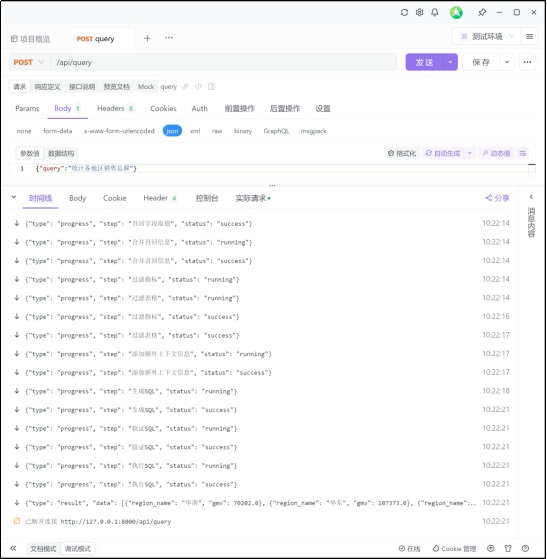 

# 8. 前后端联调

## 8.1 启动前端项目

前端代码可从课程资料获取，另外启动项目需要node运行环境，node的安装包也可从课程资料获取。

在准备好node环境后，可在前端项目的根目录执行如下命令启动项目：

安装项目所需依赖

```bash
npm install
```

启动项目

```bash
npm run dev
```

## 8.2 访问前端页面

根据命令行输出反问指定页面即可，具体效果如下：

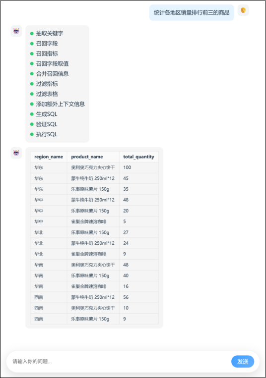