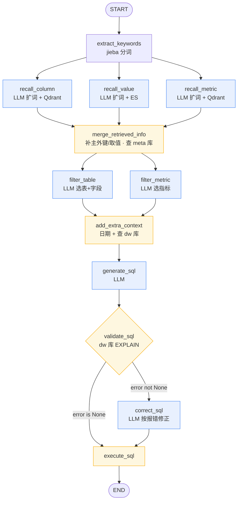

# 掌柜问数 — Python 代码导读

> 面向开发者的全量代码地图。配套源码约 2000 行 Python（55 个 `.py`，去掉空 `__init__.py` 后约 30 个实质文件）。
> 本文不重复《03-说明文档》《04-设计文档》，聚焦「代码长什么样、怎么连起来」。

---

## 0. 一句话架构

用户用中文问业务问题 → 一条 LangGraph 流水线**召回**相关 schema/指标/取值 → **生成 SQL** → **校验**（出错则**修正**）→ **执行** → 通过 SSE 把进度与结果**流式**推回前端。

严格单向分层：

```
api  →  services  →  agent(nodes)  →  repositories  →  clients
                  ↘ entities(领域对象)  models(ORM)  conf(配置)  utils/constants(基础设施)
```

---

## 1. 模块清单（按建议阅读顺序）

### ① 入口 & 基础设施

| 文件 | 行数 | 作用 |
|------|-----:|------|
| `backend/main.py` | 42 | FastAPI 启动：`0.0.0.0:8000`；CORS 只放行 `:5173`；挂 `lifespan` + `query_router`；中间件给每个请求塞 `request_id`(UUID) |
| `core/lifespan.py` | 25 | 启动 `init()` 5 个长连接客户端；关闭 `close()` 4 个（embedding 无需关） |
| `constants/project_constant.py` | 41 | `PROJECT_ROOT`：先读环境变量，否则从本文件向上找含 `.env` 的目录 |
| `conf/config_loader.py` | 11 | 泛型 `load_config(file, schema)`：`OmegaConf.load → structured → merge → to_object`，YAML→dataclass |
| `conf/app_config.py` | 88 | 7 个配置块 dataclass：`logging/db_meta/db_dw/qdrant/embedding/es/llm`。**含密钥** |
| `conf/meta_config.py` | 33 | 知识库定义 dataclass：`tables[]`(含 columns，每列有 `role`/`sync`)、`metrics[]` |
| `conf/logger.py` | 169 | loguru 封装：控制台 + 按天轮转文件；`fix_log_position` 穿透内部帧显示真实行号；`@node_log`/`@step_log` |
| `prompt/prompt_loader.py` | 6 | `load_prompt(name)` → 读 `backend/prompts/{name}.prompt` |
| `utils/data_utils.py` | 1 | `str_to_bool`（给 `--clean` 用） |

### ② 客户端层 `clients/`（4 类长连接）

| 文件 | 管理什么 | 关键接口 |
|------|---------|---------|
| `mysql_client_manager.py` | 异步 MySQL（`mysql+asyncmy`，pool_size=10，pre_ping） | `session_factory()`；全局实例 `meta_*` / `dw_*` |
| `qdrant_client_manager.py` | `AsyncQdrantClient`（6333） | `.client` → upsert / query_points |
| `es_client_manager.py` | `AsyncElasticsearch`（9200） | `.client` → bulk / search |
| `embedding_client_manager.py` | `HuggingFaceEndpointEmbeddings`（TEI 8081，bge-large-zh-v1.5） | `.client` → aembed_query / aembed_documents；`verify()` 检查 1024 维 |

### ③ 数据访问层 `repositories/` + `models/` + `entities/` + `mappers/`

**两个 MySQL 库（核心区分）：**

- **`meta` 库 = 知识库**（描述"有哪些表/字段/指标"）→ `MetaMySQLRepository`，4 张表 `table_info / column_info / metric_info / column_metric`。
- **`dw` 库 = 数据仓库**（真实业务数据，星型模型）→ `DWMySQLRepository`，方法：`get_column_types / get_column_values / get_db_info / validate_sql(EXPLAIN) / execute_sql`。

**三种召回存储：**

| 存储 | repository | collection / index | 存什么 |
|------|-----------|--------------------|--------|
| Qdrant | `column_qdrant_repository` | `data-agent-column` | 字段向量（1024 维，COSINE，阈值 0.6，top5） |
| Qdrant | `metric_qdrant_repository` | `data-agent-metric` | 指标向量 |
| ES | `value_es_repository` | `data-agent-value` | 字段**取值**（`ik_max_word` 分词，仅索引 `sync:true` 的列） |

- **entities**（领域 dataclass）：`TableInfo / ColumnInfo / MetricInfo / ColumnMetric / ValueInfo`
- **models**（SQLAlchemy ORM）：与 4 张 meta 表一一对应，`examples/alias/relevant_columns` 用 JSON 列
- **mappers**：`to_entity` / `to_model` 在 ORM ↔ entity 间双向转换

> 关键设计：每个实体的**名称、描述、每个别名**各自向量化/索引一份 → 召回能命中任意一种说法。

### ④ Agent 层 `agent/`（核心）

- `state.py` — `DataAgentState`（TypedDict，节点返回 partial dict 合并）
- `context.py` — `DataAgentContext`，注入 6 个依赖；**节点不 import 依赖，全从 `runtime.context[...]` 取**
- `llm.py` — `init_chat_model(provider="openai", temperature=0)`，指向 `app_config.llm`，`base_url` 自动补 `/v1`
- `nodes/*.py` — 12 个节点
- `graph.py` — 组装 `StateGraph` 并 `compile()`

### ⑤ Service & API 层

| 文件 | 作用 |
|------|------|
| `api/schemas/query_schema.py` | `QuerySchema{ query: str }` |
| `api/routers/query_router.py` | `POST /api/query` → `StreamingResponse(media_type="text/event-stream")` |
| `api/dependencies.py` | 每请求新建 session/repository，组装 `QueryService`（per-request 隔离） |
| `services/query_service.py` | 构造 `context`+`state`，`graph.astream(stream_mode="custom")`，chunk → `data: {json}\n\n` |
| `services/meta_knowledge_service.py`（**352 行，最大**） | 离线构建知识库 + `clean()` |
| `scripts/build_meta_knowledge.py` | CLI 入口：`--conf` / `--clean` |

---

## 2. LangGraph 流水线拓扑

源码：`backend/app/agent/graph.py`（`add_node` × 12，`add_edge` 若干 + 1 个 `add_conditional_edges`）。

```
START
  └─ extract_keywords            (jieba 分词，无 LLM)
       ├─ recall_column   ┐  LLM 扩词 + Qdrant 向量检索
       ├─ recall_value    ┤  LLM 扩词 + ES   全文检索    ← 3 路并行 fan-out
       └─ recall_metric   ┘  LLM 扩词 + Qdrant 向量检索
            └─ merge_retrieved_info        ← fan-in：补主外键/取值，按 id 去重，查 meta 库
                 ├─ filter_table  ┐  LLM 选最小必要「表+字段」  ← 2 路并行
                 └─ filter_metric ┘  LLM 选必要指标
                      └─ add_extra_context (当前日期/季度 + 查 dw 库版本方言)
                           └─ generate_sql  (LLM，输入全部 YAML 化 → 纯 SQL)
                                └─ validate_sql  (dw 库 EXPLAIN，写 error)
                                     ├─ error is None  → execute_sql ─┐
                                     └─ error not None → correct_sql ─┘  (LLM 按报错最小修正)
                                                            └─ execute_sql → END
```

**7 个 LLM 节点 + 用到的 prompt：**
`recall_column / recall_value / recall_metric`（扩展关键词）、`filter_table_info`、`filter_metric_info`、`generate_sql`、`correct_sql`。复杂入参统一 `yaml.dump(..., allow_unicode=True, sort_keys=False)` 喂给 LLM。

**进度流**：每个节点 `runtime.stream_writer({"type":"progress","step":...,"status":"running|success|error"})`；`execute_sql` 额外发 `{"type":"result","data":...}`。

同一张图的 Mermaid 版本（GitHub / PyCharm / VS Code 可直接渲染）：



> 蓝色 = 调用 LLM 的节点；黄色 = 访问数据库/存储的节点。

---

## 3. DataAgentState 字段流转图

`DataAgentState`（`agent/state.py`）是一个 TypedDict，节点各自返回 partial dict 被合并进去。下表显示**每个字段在哪一步被写入**：

| 字段 | 类型 | 由谁写入 | 含义 |
|------|------|---------|------|
| `query` | `str` | 入口（QueryService） | 用户原始问题 |
| `keywords` | `list[str]` | `extract_keywords` | jieba 分词结果 + 原问题 |
| `retrieved_columns` | `list[ColumnInfo]` | `recall_column` | Qdrant 召回的字段 |
| `retrieved_values` | `list[ValueInfo]` | `recall_value` | ES 召回的字段取值 |
| `retrieved_metrics` | `list[MetricInfo]` | `recall_metric` | Qdrant 召回的指标 |
| `table_infos` | `list[TableInfoState]` | `merge_retrieved_info` 写，`filter_table` 改 | 合并/过滤后的表+字段 |
| `metric_infos` | `list[MetricInfoState]` | `merge_retrieved_info` 写，`filter_metric` 改 | 合并/过滤后的指标 |
| `date_info` | `DateInfoState` | `add_extra_context` | 日期/星期/季度 |
| `db_info` | `DBInfoState` | `add_extra_context` | 数据库方言/版本 |
| `sql` | `str` | `generate_sql`（或 `correct_sql` 覆盖） | 待执行 SQL |
| `error` | `str \| None` | `validate_sql` | None=校验通过；否则触发 correct_sql |

逐步演进（示例问题：「统计去年各地区的销售总额」）：

```
{query}
  → +keywords
  → +retrieved_columns +retrieved_values +retrieved_metrics      (3 路并行写)
  → +table_infos +metric_infos                                   (merge 写)
  → table_infos↓ metric_infos↓ (变小，filter 原地裁剪)
  → +date_info +db_info
  → +sql
  → +error  ──(None)──────────────→ execute_sql → END
            └(not None)→ correct_sql 覆盖 sql → execute_sql → END
```

> 注意：`filter_table` / `filter_metric` 是**原地裁剪**（删表删字段），不新增 state key，只让 `table_infos`/`metric_infos` 变小。

---

## 4. 逐行精读：两个代表节点

### 4.1 `merge_retrieved_info` — fan-in 汇聚节点（无 LLM，重 DB）

源码：`backend/app/agent/nodes/merge_retrieved_info.py`。这是三路召回后的**信息整合中枢**，把零散召回结果补全成「表 → 字段」的完整结构。

```python
async def merge_retrieved_info(state, runtime):
    writer = runtime.stream_writer
    writer({"type": "progress", "step": "合并召回信息", "status": "running"})
```
- 标准签名 `(state, runtime)`，先发 `running` 进度。

```python
    retrieved_columns = state["retrieved_columns"]
    retrieved_values  = state["retrieved_values"]
    retrieved_metrics = state["retrieved_metrics"]
    meta_mysql_repository = runtime.context["meta_mysql_repository"]
```
- 读三路召回结果；**依赖从 `runtime.context` 取**，不 import。

```python
    retrieved_columns_map = {c.id: c for c in retrieved_columns}
```
- 以 `column_id` 建索引，后续所有补全都往这张 map 里塞，天然去重。

```python
    # ① 指标的相关字段也得进来（向量召回字段时可能没召到）
    for retrieved_metric in retrieved_metrics:
        for relevant_column in retrieved_metric.relevant_columns:
            if relevant_column not in retrieved_columns_map:
                column_info = await meta_mysql_repository.get_column_info_by_id(relevant_column)
                retrieved_columns_map[relevant_column] = column_info
```
- **补全点 1**：指标依赖的字段，缺啥从 meta 库按 id 捞回来。保证「选了指标却缺字段」不会发生。

```python
    # ② ES 召回的取值，挂到对应字段的 examples 上
    for retrieved_value in retrieved_values:
        column_id   = retrieved_value.column_id
        column_value = retrieved_value.value
        if column_id not in retrieved_columns_map:
            retrieved_columns_map[column_id] = await meta_mysql_repository.get_column_info_by_id(column_id)
        if column_value not in retrieved_columns_map[column_id].examples:
            retrieved_columns_map[column_id].examples.append(column_value)
```
- **补全点 2**：把命中的真实取值（如「华东」「华南」）追加进字段的 `examples`，给 LLM 写 `WHERE` 提供锚点；字段不在 map 里也先捞回来。

```python
    # ③ 按 table_id 把字段分组
    table_to_columns_map = {}
    for column in retrieved_columns_map.values():
        table_to_columns_map.setdefault(column.table_id, []).append(column)
```
- 从「一堆字段」重组为「表 → 字段列表」。

```python
    # ④ 每张表显式补齐主键/外键
    for table_id in table_to_columns_map.keys():
        key_columns = await meta_mysql_repository.get_key_columns_by_table_id(table_id)
        column_ids  = [c.id for c in table_to_columns_map[table_id]]
        for key_column in key_columns:
            if key_column.id not in column_ids:
                table_to_columns_map[table_id].append(key_column)
```
- **补全点 3（最关键）**：主外键召回往往召不到，但**没有它 JOIN 就写不出来**——这里强制补齐。

```python
    # ⑤ entity → State（TypedDict），顺带查表的描述/role
    for table_id, columns in table_to_columns_map.items():
        table = await meta_mysql_repository.get_table_info_by_id(table_id)
        columns = [ColumnInfoState(name=c.name, type=c.type, role=c.role,
                                   examples=c.examples, description=c.description, alias=c.alias)
                   for c in columns]
        table_infos.append(TableInfoState(name=table.name, role=table.role,
                                          description=table.description, columns=columns))

    metric_infos = [MetricInfoState(name=m.name, description=m.description,
                                    relevant_columns=m.relevant_columns, alias=m.alias)
                    for m in retrieved_metrics]

    writer({"type": "progress", "step": "合并召回信息", "status": "success"})
    return {"table_infos": table_infos, "metric_infos": metric_infos}
```
- 领域对象 `ColumnInfo` → `ColumnInfoState`（喂给 LLM 的精简视图，去掉了 `id`/`table_id`）。
- `except` 分支发 `error` 进度并 `raise`（整图失败由 QueryService 捕获成 SSE error）。

**一句话**：`merge` = 去重 + 三处补全（指标字段、取值示例、主外键）+ entity→State 转换。它不调 LLM，但密集查 meta 库，是「召回」到「生成」之间的承重墙。

### 4.2 `generate_sql` — 典型 LLM 节点

源码：`backend/app/agent/nodes/generate_sql.py`。所有 LLM 节点都是这个模板。

```python
async def generate_sql(state, runtime):
    writer = runtime.stream_writer
    writer({"type": "progress", "step": "生成SQL", "status": "running"})

    query        = state["query"]
    table_infos  = state["table_infos"]
    metric_infos = state["metric_infos"]
    date_info    = state["date_info"]
    db_info      = state["db_info"]
```
- 读齐生成 SQL 所需的 5 项上下文。

```python
    prompt = PromptTemplate(template=load_prompt("generate_sql"),
                            input_variables=["query","table_infos","metric_infos","date_info","db_info"])
    output_parser = StrOutputParser()
    chain = prompt | llm | output_parser
```
- **LCEL 三段式** `prompt | llm | parser`。SQL 是纯文本，所以用 `StrOutputParser`；而 recall/filter 节点输出 JSON，用的是 `JsonOutputParser`。

```python
    result = await chain.ainvoke({
        "query": query,
        "table_infos":  yaml.dump(table_infos,  allow_unicode=True, sort_keys=False),
        "metric_infos": yaml.dump(metric_infos, allow_unicode=True, sort_keys=False),
        "date_info":    yaml.dump(date_info,    allow_unicode=True, sort_keys=False),
        "db_info":      yaml.dump(db_info,      allow_unicode=True, sort_keys=False),
    })
```
- **统一 YAML 序列化**：嵌套结构转 YAML 比 JSON 更省 token、更易读；`allow_unicode=True` 保留中文，`sort_keys=False` 保持字段原序。

```python
    writer({"type": "progress", "step": "生成SQL", "status": "success"})
    logger.info(f"生成的SQL: {result}")
    return {"sql": result}
```
- 写回 `sql`；异常分支同样发 error 进度并 `raise`。

**模板共性**：`读 state → load_prompt → prompt|llm|parser → ainvoke(YAML 入参) → 写回 partial dict`，配 running/success/error 三态进度。读懂这一个，7 个 LLM 节点全通。

---

## 5. 两条主流程

**离线（建知识库，跑一次）：**
```
build_meta_knowledge.py
  → MetaKnowledgeService.build(meta_config.yaml)
     ├─ _save_tables_to_meta_db    (查 dw 拿字段类型/示例 → 写 meta 库)
     ├─ _save_column_info_to_qdrant(名/描述/每个别名各嵌一份，batch=10)
     ├─ _save_value_info_to_es     (sync 列取值，最多 10 万条)
     ├─ _save_metrics_to_meta_db
     └─ _save_metric_info_to_qdrant
  --clean → clean()：按外键序清 MySQL(column_metric→metric_info→column_info→table_info) → 删 Qdrant collection → 删 ES index
```

**在线（每次提问）：**
```
POST /api/query
  → query_router → Depends(get_query_service)         (dependencies.py 每请求新建 session/repo)
  → QueryService.query → graph.astream(stream_mode="custom")
     召回(Qdrant×2 + ES) → merge(meta 库补全) → filter(LLM) → add_extra_context(dw 库)
     → generate_sql → validate_sql →(错则 correct_sql)→ execute_sql
  → 每个 chunk: yield  data: {json}\n\n   (SSE)
```

`QueryService.query`（`services/query_service.py`）整段就是：组 `context` + `state` → `astream` → 把每个 chunk 包成 `data: ...\n\n`，并用 `try/except` 把任何异常兜成 `{"type":"error"}` 的 SSE 行。

---

## 6. 值得记住的 5 个设计点

1. **依赖全靠注入**：节点签名固定 `async def node(state, runtime)`，外部能力一律 `runtime.context[...]` 取——好测试、可替换、无循环 import。
2. **per-request 仓库 + 全局长连接分离**：引擎/客户端在 `lifespan` 建一次；每请求只开新 session（`dependencies.py`），互不污染。
3. **「最小必要集合」写进 prompt**：`filter_table`/`filter_metric` 明确禁止兜底保留、禁止新增表字段，压缩 SQL 上下文体积。
4. **自愈环**：`validate_sql` 用 `EXPLAIN` 试错且**不抛异常**（错误写进 state），条件边决定是否进 `correct_sql`，最多修一次再执行。
5. **多表征召回**：name / description / 每个 alias 各存一份向量或 ES 文档，召回鲁棒——用户怎么叫都能命中。

---

## 7. 逐行精读：其余 5 个 LLM 节点

第 4 节讲了 `generate_sql` 这个 LLM 节点模板。剩下 6 个 LLM 节点都套同一壳子，差异只在三处：**用哪个 prompt、用哪个 OutputParser、拿到结果后怎么处理**。下表先总览，再逐个看差异点。

| 节点 | prompt | parser | 结果用途 |
|------|--------|--------|---------|
| `recall_column` | `extend_keywords_for_column_recall` | `JsonOutputParser` | 扩展词 → 逐词向量检索 Qdrant |
| `recall_value` | `extend_keywords_for_value_recall` | `JsonOutputParser` | 扩展词 → 逐词全文检索 ES |
| `recall_metric` | `extend_keywords_for_metric_recall` | `JsonOutputParser` | 扩展词 → 逐词向量检索 Qdrant |
| `filter_table` | `filter_table_info` | `JsonOutputParser` | `{表:[字段]}` → 原地裁剪 table_infos |
| `filter_metric` | `filter_metric_info` | `JsonOutputParser` | `[指标名]` → 原地裁剪 metric_infos |
| `correct_sql` | `correct_sql` | `StrOutputParser` | 纯 SQL → 覆盖 state["sql"] |

> 关键区别：**召回/过滤节点输出 JSON** 用 `JsonOutputParser`；**生成/修正 SQL 输出纯文本** 用 `StrOutputParser`。

### 7.1 三个 recall 节点——同构（以 `recall_column` 为例）

源码 `nodes/recall_column.py`。三个召回节点结构几乎逐行相同，只换检索后端。

```python
    query    = state["query"]
    keywords = state["keywords"]                          # 来自 extract_keywords 的 jieba 结果
    embedding_client         = runtime.context["embedding_client"]
    column_qdrant_repository = runtime.context["column_qdrant_repository"]

    # ① LLM 扩词：只把原始 query 丢进去，让模型补充"字段级"近义词
    prompt = PromptTemplate(template=load_prompt("extend_keywords_for_column_recall"),
                            input_variables=["query"])
    chain  = prompt | llm | JsonOutputParser()
    result = await chain.ainvoke({"query": query})        # result 是 list[str]

    # ② 合并：jieba 关键词 ∪ LLM 扩展词，去重
    keywords = list(set(keywords + result))

    # ③ 逐个关键词：embed → Qdrant 向量检索 → 按 id 去重塞进 map
    retrieved_columns_map = {}
    for keyword in keywords:
        embedding = await embedding_client.aembed_query(keyword)
        payloads  = await column_qdrant_repository.search(embedding)   # list[ColumnInfo]
        for payload in payloads:
            retrieved_columns_map.setdefault(payload.id, payload)
    return {"retrieved_columns": list(retrieved_columns_map.values())}
```

三者的唯一差异：

| 节点 | ② 之后第 ③ 步检索方式 | 写回字段 |
|------|----------------------|---------|
| `recall_column` | `aembed_query` → `column_qdrant_repository.search(embedding)` | `retrieved_columns` |
| `recall_metric` | `aembed_query` → `metric_qdrant_repository.search(embedding)` | `retrieved_metrics` |
| `recall_value` | **不做 embedding**，直接 `value_es_repository.search(keyword)`（ES 全文，关键词原样进） | `retrieved_values` |

> 记住一点：`recall_value` 走 ES 全文检索，**没有向量化这一步**——取值匹配靠 IK 分词的字面命中，而非语义相似。

### 7.2 `filter_table` / `filter_metric`——LLM 输出 JSON 后「原地裁剪」

源码 `nodes/filter_table.py`。注意它**不构造新列表**，而是直接在 `state["table_infos"]` 上 `remove`。

```python
    query       = state["query"]
    table_infos = state["table_infos"]                    # merge 阶段产出的候选

    prompt = PromptTemplate(template=load_prompt("filter_table_info"),
                            input_variables=["query", "table_infos"])
    chain  = prompt | llm | JsonOutputParser()
    result = await chain.ainvoke(
        {"query": query, "table_infos": yaml.dump(table_infos, allow_unicode=True, sort_keys=False)})
    # result 形如: {'fact_order': ['order_amount','region_id'], 'dim_region': ['region_id','region_name']}

    for table_info in table_infos[:]:                     # 注意 [:] 拷贝遍历，边遍历边删
        if table_info["name"] not in result:
            table_infos.remove(table_info)                # 整张表没被选中 → 删表
        else:
            selected = result[table_info["name"]]
            for column_info in table_info["columns"][:]:
                if column_info["name"] not in selected:
                    table_info["columns"].remove(column_info)   # 表保留但删掉没选中的字段
    return {"table_infos": table_infos}
```

要点：
- `table_infos[:]` 是**遍历期间安全删除**的惯用法（遍历副本、删原列表）。
- 两层裁剪：先删整表，再删表内字段。LLM 只回 `{表名:[字段名]}`，**不会新增**，所以裁剪是安全的子集操作。
- `filter_metric` 更简单：LLM 回 `[指标名,...]`，只做一层「指标名不在结果里就删」。

`filter_metric.py` 核心：
```python
    result = await chain.ainvoke({"query": query, "metric_infos": yaml.dump(metric_infos, ...)})
    for metric_info in metric_infos[:]:
        if metric_info["name"] not in result:
            metric_infos.remove(metric_info)
    return {"metric_infos": metric_infos}
```

### 7.3 `correct_sql`——读 7 个入参，输出新 SQL 覆盖

源码 `nodes/correct_sql.py`。它是 `generate_sql` 的「带报错重试版」，多读了 `sql` 和 `error` 两项。

```python
    sql   = state["sql"]                                  # 上一版出错的 SQL
    error = state["error"]                                # validate_sql 写入的报错文本
    query, table_infos, metric_infos, date_info, db_info = ...  # 与 generate_sql 相同的 5 项

    prompt = PromptTemplate(template=load_prompt("correct_sql"),
                            input_variables=["query","table_infos","metric_infos","date_info","db_info","sql","error"])
    chain  = prompt | llm | StrOutputParser()
    result = await chain.ainvoke({... 5 项 YAML ..., "sql": sql, "error": error})
    return {"sql": result}                                # 覆盖 state["sql"]，随后直接 execute_sql
```

要点：
- 输出仍是纯 SQL（`StrOutputParser`），写回同一个 `sql` key，**覆盖**旧值。
- prompt 里约束「仅按 error 做最小修正、保持原业务语义、禁止写操作」。
- 流程上 `correct_sql` 之后**直接到 `execute_sql`**（不再二次 validate）——所以这是「一次性纠错」，修一次就执行。

---

## 8. 逐行精读：4 个客户端管理器

`clients/` 下 4 个 manager 是同一个模式：**构造时只存 config（不连），`init()` 才真正建连，全局单例**。它们被 `lifespan` 在应用启动时统一 `init()`。

### 8.1 `MysqlClientManager`——唯一带连接池的

源码 `clients/mysql_client_manager.py`。

```python
class MysqlClientManager:
    def __init__(self, db_config: DBConfig):
        self.db_config = db_config
        self.engine = None
        self.session_factory = None

    def _get_url(self):
        return f"mysql+asyncmy://{user}:{password}@{host}:{port}/{database}?charset=utf8mb4"

    def init(self):
        self.engine = create_async_engine(url=self._get_url(),
                                          pool_size=10,        # 连接池 10
                                          pool_pre_ping=True)  # 取连接前 ping 一下，防断连
        self.session_factory = async_sessionmaker(self.engine,
                                                  autoflush=True,
                                                  expire_on_commit=False,  # commit 后对象仍可读
                                                  autobegin=True)

    async def close(self):
        await self.engine.dispose()

dw_mysql_client_manager   = MysqlClientManager(app_config.db_dw)    # 全局单例 ×2
meta_mysql_client_manager = MysqlClientManager(app_config.db_meta)
```

要点：
- **驱动 `mysql+asyncmy`**（纯异步），所以全链路 `await`。
- **同一个类，两个实例**分别连 `dw` 库和 `meta` 库——这就是「两个 MySQL 库」在代码里的落点。
- `expire_on_commit=False` 很关键：repository 里 `session.begin()` 提交后，返回的 entity 仍能读属性，不会触发懒加载报错。
- 暴露给上层的就一个 `session_factory()`，`dependencies.py` 每请求调它开新 session。

### 8.2 `QdrantClientManager` / `ESClientManager`——极薄壳

两者几乎一样，都只是「拼 URL → new 异步 client → close」。

```python
# qdrant_client_manager.py
def init(self):  self.client = AsyncQdrantClient(url=f"http://{host}:{port}")   # 默认 6333
async def close(self):  await self.client.close()
qdrant_client_manager = QdrantClientManager(app_config.qdrant)    # 单例

# es_client_manager.py
def init(self):  self.client = AsyncElasticsearch(hosts=[f"http://{host}:{port}"])  # 默认 9200
async def close(self):  await self.client.close()
es_client_manager = ESClientManager(app_config.es)                # 单例
```

要点：
- 它们只**暴露原始 `.client`**，真正的「建 collection / 建 index / upsert / search」逻辑在 `repositories/qdrant/*` 和 `repositories/es/*` 里，client 只管连接。
- 两个文件底部的 `if __name__ == '__main__'` 是冒烟测试（建临时 collection/index 跑一遍），可 `uv run python -m backend.app.clients.qdrant_client_manager` 单独验证连通性。

### 8.3 `EmbeddingClientManager`——LangChain 封装 + 自带 verify

源码 `clients/embedding_client_manager.py`。

```python
def init(self):
    self.client = HuggingFaceEndpointEmbeddings(model=self._get_url())   # model 传的是 URL，指向自托管 TEI

def verify(self) -> bool:
    embedding = self.client.embed_query("测试文本")
    # 打印维度（应为 1024）和前 3 个值，失败返回 False
```

要点：
- 用 LangChain 的 `HuggingFaceEndpointEmbeddings`，`model=` 这里传的是**本地 TEI 服务地址**（`http://host:port`），不是 HF 模型名——所以走的是自托管 8081 端口，不联网。
- ⚠️ 注意：`init()` 里**没有把 `app_config.embedding.model` 传进去**，配置里的 `model` 字段当前未被使用——模型由 TEI 服务端决定（`bge-large-zh-v1.5`）。
- 多了个 `verify()`：embed 一句「测试文本」打印维度，是环境验证脚本（《02-环境验证脚本》）调用的健康检查。
- **没有 `close()`**——所以 `lifespan` 关闭时只 close 另外 3 个，embedding 不需要。
- 文件底部还附了一段 `verify_embedding_service()` 可执行脚本，`uv run python -m backend.app.clients.embedding_client_manager` 即可单测嵌入服务。

> 四者共性回顾：**配置注入构造、init 延迟建连、全局单例、lifespan 统一管理生命周期**。其中只有 MySQL 有连接池和 `session_factory`；其余三个直接暴露 `.client` 给 repository 用。