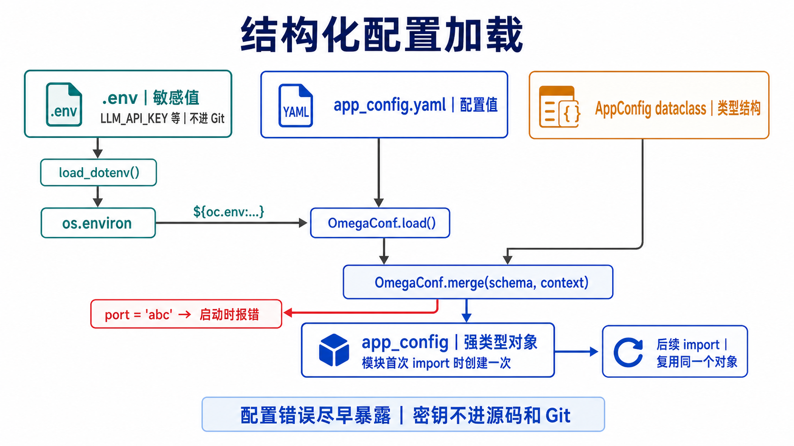
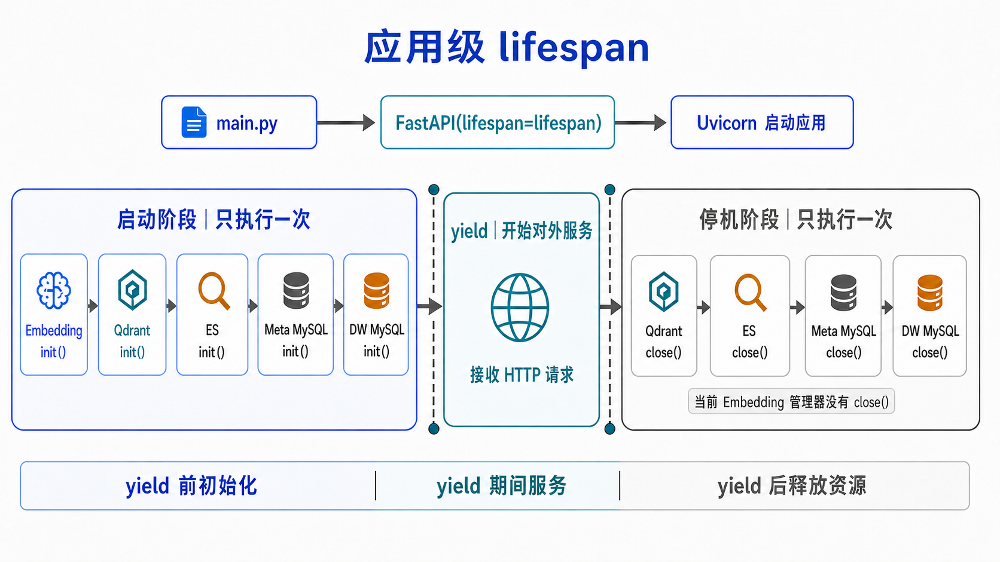
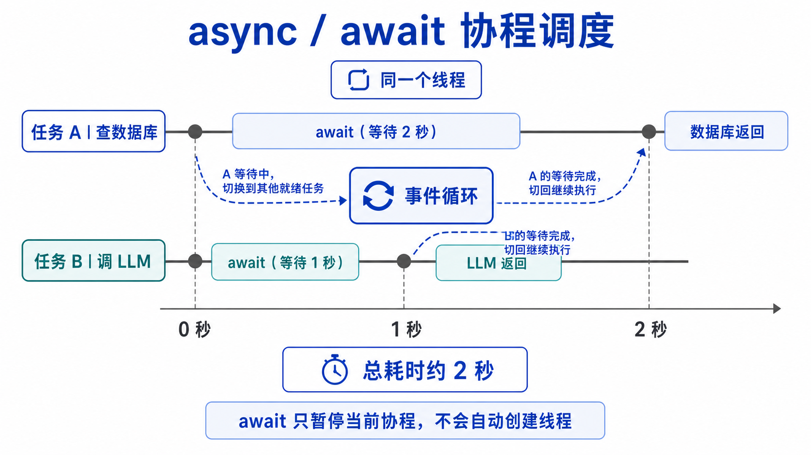
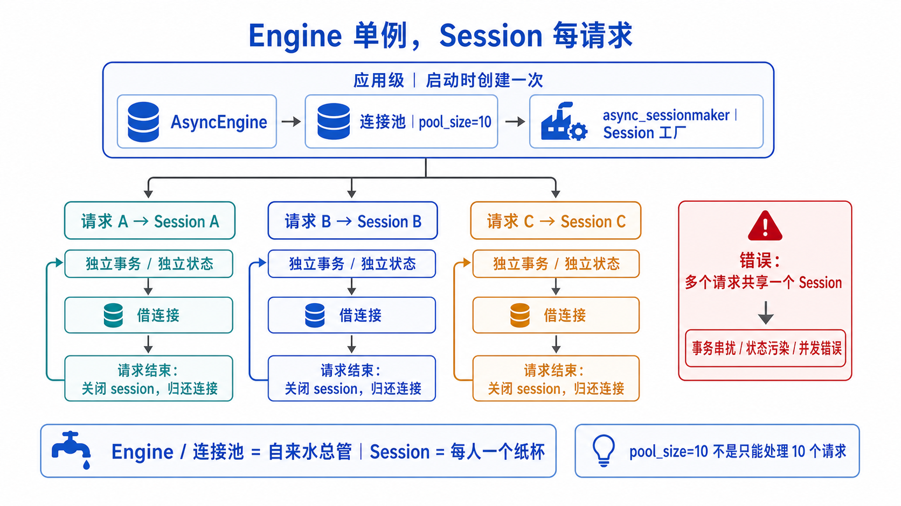
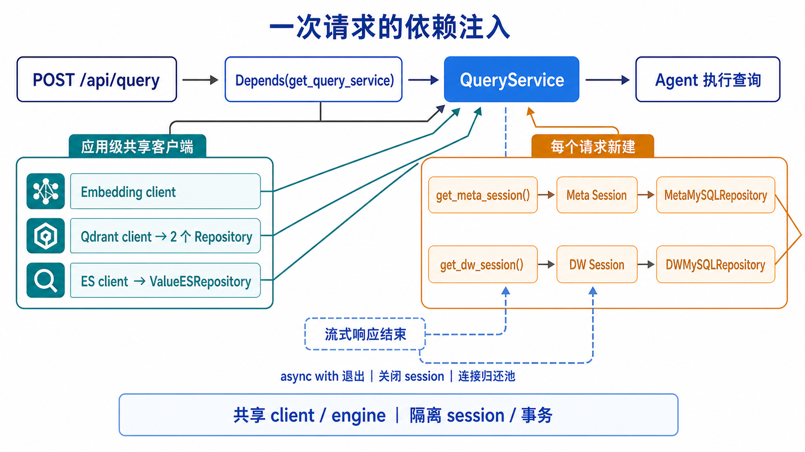
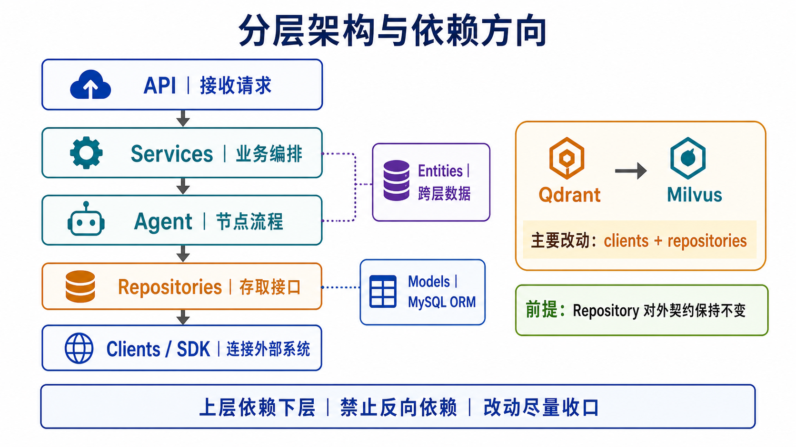

# 教案详案 · 第 3 讲：工程基础设施

> 教师授课用逐段细案，配合 `03-工程基础设施.md`（学生教案）使用。
> 体例：⏱ 时间 / 🗣 讲稿 / ✍ 板书 / ❓ 提问 / 💻 上机 / ⚠ 预案。

---

## 一、本讲定位与教学法说明

- **性质**：第一节深入代码的课。讲“地基”——配置、日志、客户端、分层。
- **核心矛盾**：这些内容“不出活”（不像智能体那样有炫酷效果），学生容易觉得无聊。要让他们明白——**这正是从“能跑的 Demo”到“工业级服务”的分水岭，是走向职场最该补的功夫**。
- **必须钉死的认知**：
  1. **结构化配置**：配置错了在启动时就暴露，而不是运行到一半才崩。
  2. **引擎单例、session 每请求**：生命周期不同，混用会出事。
  3. **分层 + 依赖单向向下**。
- **教学法**：每讲一个基础设施，都问“**不这样做会怎样**”，用反例凸显价值。**以痛点驱动，而非罗列特性**。
- **总时长**：4 学时（理论约 85 分钟 + 上机约 95 分钟）。

---

## 二、课时分配总览

| 段落 | 内容 | 时长 |
| --- | --- | --- |
| 0 | 开场：什么是“地基”，为什么重要 | 6 min |
| 1 | 配置管理：YAML×dataclass×OmegaConf | 18 min |
| 2 | 项目根定位 + 日志 | 14 min |
| 3 | 客户端管理器：统一 init/close | 14 min |
| 4 | 引擎单例 vs session 每请求（难点） | 16 min |
| 5 | 分层架构与依赖方向 + 小结 | 12 min |
| —— | 课间 | 10 min |
| 6 | 上机：跑各模块 __main__ 自测 | 85 min |
| 7 | 作业与预告 | 10 min |

---

## 三、逐段细案（理论部分）

### 段落 0 · 开场：什么是“地基”（6 min）

⏱ 0:00–0:06

🗣 **讲稿**：
- “前两讲我们看了全景、搭了环境。今天进代码，但先不碰智能体——先看**地基**：配置、日志、数据库连接、分层。”
- 打预防针 + 立意：“这部分没有炫酷效果，但它是‘能跑的作业’和‘工业级服务’的分水岭。**面试官最爱问的、入职最先用的，往往不是模型，而是这些**。认真学，受益最久。”

✍ **板书（主板，保留）**：
```
地基四件套: 配置 / 日志 / 客户端管理 / 分层
分水岭: 玩具Demo ←→ 工业级服务
今天的口头禅: "不这样做会怎样?"
```

---

### 段落 1 · 配置管理（18 min）

⏱ 0:06–0:24

> 钉死认知 1。重点是“结构化配置的价值”。

🗣 **讲稿**：打开 `backend/app/conf/app_config.py`，先看 dataclass：
```python
@dataclass
class DBConfig:
    host: str; port: int; user: str; password: str; database: str
@dataclass
class AppConfig:
    logging: LoggingConfig; db_meta: DBConfig; db_dw: DBConfig
    qdrant: QdrantConfig; embedding: EmbeddingConfig; es: ESConfig; llm: LLMConfig
```
再看加载三行：
```python
context = OmegaConf.load(config_file)                # 读 YAML
schema  = OmegaConf.structured(AppConfig)            # dataclass 当 schema
app_config = OmegaConf.to_object(OmegaConf.merge(schema, context))  # 合并+类型校验
```



🗣 **看图收口**：`.env` 先把密码等敏感值放入环境变量，YAML 再用 `${oc.env:...}` 引用；`OmegaConf` 将 YAML 与 dataclass 定义的结构合并，最后才得到业务代码使用的 `app_config`。它不只是“读一个 YAML”，还同时做了结构和类型约束。

🗣 **讲透“结构化”价值（口头禅）**：
> “**不用 dataclass 会怎样？**——直接 `yaml.load` 得到一个 dict，`config['db_meta']['port']` 这样取。问题来了：万一 YAML 里 port 写成了字符串 `'3306'`、或者拼错成 `prot`，你**运行到连数据库那一刻才崩**。而用结构化配置，`OmegaConf.merge` 在**启动时**就按 dataclass 校验类型——错了立刻报，不留到半夜生产环境炸。”

🗣 `app_config` 是模块级单例：“全项目 `from ... import app_config` 直接用，因为它只读、无状态。”

⚠ **安全提醒（必讲，立规矩）**：
> “看 `app_config.yaml` 里有 LLM 的 `api_key` 和数据库密码。这是教学项目图方便。**真实项目里，密钥绝不能写进代码、绝不能进 Git。** 该从环境变量读。这个意识从现在养成——这是练习里要你改的（挑战题）。”

✍ **板书（重点）**：
```
配置: YAML --OmegaConf.merge(schema)--> 强类型对象
结构化的价值: 配置错→启动时报, 不留到运行时炸
app_config = 模块级单例(只读无状态,安全)
⚠ 密钥不进代码/不进Git!
```

---

### 段落 2 · 项目根定位 + 日志（14 min）

⏱ 0:24–0:38

#### 2a. 项目根定位（5 min）
🗣 打开 `backend/app/constants/project_constant.py`，讲 `_find_project_root`：
> “很多路径要相对‘项目根’算。这里的策略是：**先读环境变量 PROJECT_ROOT（生产/Docker 用），否则从当前文件往上递归找 .env（开发用）**。一套代码兼容开发和部署——这是个通用技巧。”（回忆第 2 讲 Makefile 注入 PROJECT_ROOT。）

#### 2b. 日志（9 min）
🗣 打开 `backend/app/conf/logger.py`，讲三个亮点（不逐行）：
1. **配置驱动**：`.env` 控制开关、级别、保留天数。
2. **双输出 + 按天切割**：控制台彩色 + `logs/app_YYYYMMDD.log`。
3. **位置精准**（口头禅）：
   > “`fix_log_position` 遍历调用栈，跳过 loguru 内部和 logger.py 自己。**不这样会怎样？**——日志里每行都显示 `logger.py:120`，根本不知道是哪个业务文件打的，debug 时抓瞎。修了之后，日志精准指向真实调用处。”

🗣 提一句 request_id（和第 8 讲呼应）：“日志格式里能注入 request_id，把一次请求的所有日志串起来——第 8 讲讲中间件时再看怎么注入。”

✍ **板书（副板）**：
```
项目根: 先环境变量 PROJECT_ROOT, 否则向上找.env (兼容开发/部署)
日志(loguru): 配置驱动 + 双输出按天切 + 位置精准(否则全显logger.py)
```

---

### 段落 3 · 客户端管理器：统一 init/close（14 min）

⏱ 0:38–0:52

🗣 **讲稿**：Embedding、Qdrant、ES、MySQL 四类客户端都有管理器，模式统一；其中 MySQL 因为同时连接 `meta` 和 `dw` 两个库，所以会有两个管理器实例。先给“统一模板”：
```
class XxxClientManager:
    def __init__(self, config): self.client=None; self.config=config
    def init(self):  self.client = 建连接(...)
    async def close(self): await self.client.close()
xxx_client_manager = XxxClientManager(app_config.xxx)   # 模块级单例
```

🗣 **这些 `init/close` 由谁调？** 打开 `backend/app/core/lifespan.py`。`backend/main.py` 创建 FastAPI 时传入 `lifespan`：`yield` 之前统一初始化客户端，`yield` 期间对外处理请求，`yield` 之后再释放资源。Embedding 客户端没有需要显式关闭的长连接，因此关闭阶段没有它。



🗣 打开两个对比看：
- `embedding_client_manager.py`：`init()` 建 `HuggingFaceEndpointEmbeddings`，还带个 `verify()` 自检（发请求看返回维度）。
- `mysql_client_manager.py`（**重点**）：
  ```python
  def init(self):
      self.engine = create_async_engine(url=..., pool_size=10, pool_pre_ping=True)  # 连接池
      self.session_factory = async_sessionmaker(self.engine, expire_on_commit=False, ...)
  dw_mysql_client_manager   = MysqlClientManager(app_config.db_dw)    # 两个库两个管理器
  meta_mysql_client_manager = MysqlClientManager(app_config.db_meta)
  ```
🗣 讲三个点：
- `mysql+asyncmy://`：异步驱动，配合 `await` 高并发。
- `pool_size=10`：连接池，复用连接。
- `pool_pre_ping=True`（口头禅）：“取连接前先 ping。**不开会怎样？**——连接池里有个被 MySQL 超时断掉的死连接，你取来一用，第一条语句就报 ‘MySQL gone away’。开了 pre_ping 就自动剔除死连接。这是生产环境的偶发 bug 杀手。”

🗣 **补一个 `await` 的直觉**：异步不等于“每个任务新建一条线程”。当协程 A 等 MySQL 返回时，`await` 把控制权交还给事件循环；事件循环可以先推进协程 B，而不是让整条线程陪 A 干等。



✍ **板书（副板）**：
```
客户端管理器: 统一 init()建连 / close()释放 / 模块级单例
MySQL: 异步驱动asyncmy + 连接池pool_size + pre_ping(防死连接)
两个库→两个管理器(dw/meta)
```

---

### 段落 4 · 引擎单例 vs session 每请求（难点，16 min）

⏱ 0:52–1:08

> 钉死认知 2。这是学生最易忽视、却最重要的一点，和第 8 讲依赖注入直接呼应。

🗣 **抛问题**：“连接池 engine 是单例（init 建一次），但 **session 绝不能单例**，必须每个请求新建。为什么？”

🗣 **讲透两种生命周期**：
> “**engine/连接池**：建立成本高（TCP、握手），又是无状态的‘连接仓库’，应该应用启动建一次、全程复用 → 单例。
> **session（会话）**：它代表‘一次工作单元/一个事务上下文’，是**有状态的**。如果多个请求共享一个 session——A 请求的事务还没提交，B 请求的查询混进来，事务串扰、对象状态污染、并发直接报错。所以 session 必须**短命、每请求一个、用完即弃**。”



🗣 用比喻收口：
> “engine 像‘自来水总管道’（建好一直用），session 像‘一次性纸杯’（每人一个，用完扔）。你不会让全办公室共用一个纸杯喝水。”

🗣 **在本项目里找到转换点**：打开 `backend/app/api/dependencies.py`：
```python
async def get_meta_session():
    async with meta_mysql_client_manager.session_factory() as session:
        yield session

async def get_meta_mysql_repository(
    session: AsyncSession = Depends(get_meta_session),
):
    return MetaMySQLRepository(session)
```
`session_factory()` 为当前请求创建 session；`yield` 把它交给 Repository/Service 使用；请求结束后退出 `async with`，session 自动关闭，底层连接归还连接池。



🗣 **和第 8 讲的关系**：今天只借这段代码证明“session 每请求一个”确实落地；第 8 讲再系统展开 FastAPI 依赖注入链。

✍ **板书（重点框起来）**：
```
┌────────────────────────────────────────┐
│ engine/连接池 = 单例(启动建一次,复用)     │  自来水总管
│ session       = 每请求新建(短命,用完弃)   │  一次性纸杯
│ 混用→事务串扰/状态污染/并发错             │
└────────────────────────────────────────┘
怎么实现"每请求一个"? → 第8讲 Depends + async with
```

---

### 段落 5 · 分层架构与依赖方向 + 小结（12 min）

⏱ 1:08–1:20

🗣 **讲分层**：先看图，再沿着一次查询的调用方向从上往下走：`API → Services → Agent → Repositories → Clients/SDK`。`entities` 支撑业务层之间传递数据，`models` 则主要为 Repository 提供 ORM 映射。


🗣 讲“依赖单向向下”（口头禅）：
> “上层依赖下层，**绝不反向**。**反过来会怎样？**——clients 依赖 repositories 就成了循环依赖，谁都没法独立编译/测试，改一处牵全身。单向依赖让每层能独立测试、独立替换。”

❓ **提问（第 3 讲思考题 4）**：“如果把向量库从 Qdrant 换成 Milvus，按这个分层，要改哪几层、不用改哪几层？”
🗣答：“改 clients + repositories/qdrant；不用改 entities/services/agent——因为它们依赖 repository 的**方法签名**，不关心底层是 Qdrant 还是 Milvus。**这就是分层的回报。**”

🗣 **小结三句**：
1. 结构化配置——错误在启动时暴露。
2. engine 单例、session 每请求——生命周期不同。
3. 分层 + 单向依赖——可测试、可替换。

---

## 四、上机部分细案（85 min）

⏱ 1:30–2:55

### 💻 上机任务 1：验证配置加载（20 min）
```sh
uv run python -m backend.app.conf.app_config      # 打印 es.host
uv run python -m backend.app.conf.meta_config     # 看 meta schema
```
⚠ 预案：必须用 `-m` 模块方式跑（绝对导入）。直接 `python xxx.py` 会 import 失败——借此强化第 1/2 讲的启动方式。

**加做**：故意把 `app_config.yaml` 里某个 port 改成非数字，重跑，观察启动期就报类型错——亲历“结构化配置”的价值。

### 💻 上机任务 2：体验日志（20 min）
```sh
uv run python -m backend.app.conf.logger          # 看彩色日志+异常堆栈
```
❓ 检查点：日志里显示的“文件名:函数:行号”，指向的是 logger.py 还是真实调用处？（验证位置精准修复。）

### 💻 上机任务 3：逐个连通三大存储（35 min）
> 每个客户端管理器都带 `__main__` 自测，挨个跑，确认地基连得通。
```sh
uv run python -m backend.app.clients.mysql_client_manager      # 查 meta.table_info
uv run python -m backend.app.clients.qdrant_client_manager     # 建临时collection+查询
uv run python -m backend.app.clients.es_client_manager         # 建my-books索引+搜索
uv run python -m backend.app.clients.embedding_client_manager  # verify: 返回1024维
```
❓ 检查点：embedding 的 verify 输出的向量维度是多少？（1024，呼应配置 embedding_size。）

---

## 五、作业与下讲预告（10 min）

🗣 **布置作业**：
- 必做（⭐）：练习 1（加一个配置块 + 对应 dataclass，再故意写错类型看报错）。
- 推荐（⭐⭐）：练习 3（给 MySQL 管理器加 `verify()`，`SELECT 1` 自检）。
- **指向大作业（⭐⭐⭐）：练习 5（把密钥从 yaml 抽到环境变量，用 `${oc.env:...}`）**——真实项目必做的安全加固。
- 思考题 1、2、4 书面作答。

🗣 **下讲预告**：“地基打好，下一讲开始建‘元数据知识库’——把数仓的表、字段、指标，组织成能约束大模型、防它幻觉的‘知识’。这是整个系统准确性的根。”

---

## 六、本讲常见问题预案

| 学生可能问 | 应对 |
| --- | --- |
| 直接 python xxx.py 报 import 错 | 必须 -m 模块方式(绝对导入) |
| 为什么 app_config 能单例 session 不能 | 配置只读无状态;session有事务态,共享会串扰 |
| pool_pre_ping 有啥用 | 取连接前ping,剔除被超时断掉的死连接 |
| expire_on_commit=False 干嘛的 | commit后对象属性仍可访问,不触发额外查询 |
| 分层是不是过度设计 | 小项目可省;本项目要跨层传对象/可替换存储,分层有回报 |

---

## 七、板书最终态

```
地基四件套: 配置 / 日志 / 客户端 / 分层    口头禅:"不这样会怎样?"

配置: YAML→OmegaConf.merge(dataclass)→强类型; 错误启动时暴露
      ⚠密钥不进代码/Git
日志: 配置驱动+按天切+位置精准(否则全显logger.py)
客户端: 统一init/close+单例; MySQL异步+连接池+pre_ping

【核心】engine单例(总管道) vs session每请求(一次性纸杯)
        混用→事务串扰; 怎么每请求一个→第8讲Depends

分层: api→services→agent→repositories→clients (单向向下)
      换Qdrant为Milvus只改clients+repository, 上层不动
```
